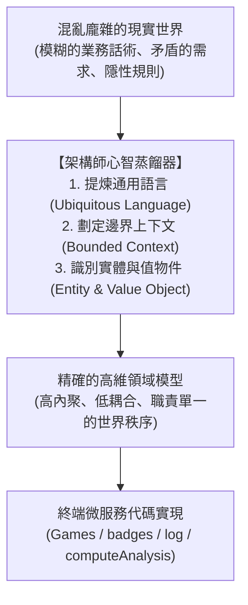

# 高維抽象思維：為什麼優秀的架構需要由上而下（Top-Down）的秩序感

> **「初級工程師在程式碼裡迷失，中級工程師在設計模式中掙扎，而頂級架構師則是在混亂的現實世界與冰冷的機器之間，建立高維的秩序與法則。」**

---

## 一、 認知的維度：局部泥潭 vs. 上帝視角

軟體開發中最常見的悲劇，源自於**「維度認知錯誤」**：

* **低維的由下而上（Bottom-Up）視角**：  
  開發者從一個資料表、一個 API 端點或一個 Controller 開始寫起。需要加新功能時，就在既有的 Service 裡追加一個 `if-else` 或再呼叫一個遠端介面。在這種視角下，系統永遠只是「幾千個類別與幾萬行語法」的拼湊物。隨著功能膨脹，系統熵值（Entropy）迅速暴增，終將演變成無人能掌握的「大泥球（Big Ball of Mud）」。
* **高維的由上而下（Top-Down）秩序感**：  
  架構師在動手寫哪怕一行代碼之前，首先在思維層面完成全域沙盤推演——這套系統的**核心商業領域是什麼？邊界（Bounded Context）在哪裡？領域與領域之間依循何種契約協同？哪些是瞬息萬變的外圍，哪些是永恆不變的核心？**

**代碼只是現實世界的低維投影，而架構才是支撐這套投影的高維心智流形（Manifold）。**

---

## 二、 領域驅動（DDD）的本質：現實世界的概念蒸餾

很多人把領域驅動設計（DDD）誤認為是「充血模型」、「Repository 模式」或「聚合根（Aggregate Root）」等語法教條。但從高維哲學來看，DDD 的真諦在於**「認知降維與概念蒸餾」**：

### 1. 通用語言（Ubiquitous Language）即思想統一
如果產品經理說的「訂單」、客服說的「訂單」與後端資料庫存的「訂單」概念不一致，這套系統註定崩潰。高維架構的第一步，是消除模糊與歧義，建立全域無二義性的語言模型。

### 2. 邊界上下文（Bounded Context）即世界的分野
一個名詞在不同的世界裡擁有完全不同的含義：
* 在「遊戲服務（Games）」中，玩家是一個即時輸入文本、判定拼音的連線會話；
* 在「成就服務（badges）」中，玩家是一串歷史行為日誌與榮譽勳章的聚合進度；
* 在「報表服務（reports）」中，玩家只是匯總統計中的一行冷冰冰的 CSV 數字。
**優秀架構的本質，不是試圖建立一個包羅萬象的大一統物件，而是劃清邊界，讓每一個世界在自己的上下文裡達到最高純度的自治。**

---

## 三、 契約先行（Contract-First）：無形統治的最高境界

在分散式與微服務體系中，最危險的陷阱莫過於「各服務憑感覺寫接口，聯調時才發現參數對不上、格式不一致」。

真正的秩序感，必須依賴**「規格立法（Specification & Contract）」**先行：

1. **契約是系統的「憲法」**：  
   在任何業務服務落實寫代碼前，資料傳輸契約（JSON Schema、Message Payload、狀態碼定義）必須先在架構中樞定稿。代碼可以被重構、資料庫可以被替換，但**跨領域的契約是永恆的公約**。
2. **規格先行的降維優勢**：
   * **消除猜測與溝通成本**：調用方與被調用方不需要每週開跨部門會議確認欄位含義，Schema 的定義就是唯一真相來源（Single Source of Truth）。
   * **並行開發與解耦**：契約一旦鎖定，被依賴方與依賴方可以同時進入實作，甚至先用 Mock 資料進行獨立測試，將跨團隊依賴的摩擦係數降至最低。

---

## 四、 架構師的心法：在抽象與具體之間穿梭

高維抽象思維絕非脫離現實的空中樓閣，一位真正頂級的架構師，必須具備**「雙向穿梭的認知能力」**：

* **能升維（Abstraction）**：面對混亂破碎的需求，能抽絲剝繭，看透商業本質，在白板上用三四個邊界與幾條流向圖定下乾坤；
* **能降維（Grounded Execution）**：面對具體落地，能精準洞察資料庫死鎖、網路逾時、序列化反序列化開銷與執行緒安全性。

當你掌握了這種「由上而下建立秩序、由下而上支撐細節」的抽象思維時，你就不再是一個被需求追著跑的碼農，而是**整個數位世界的造物主與秩序締造者**。
