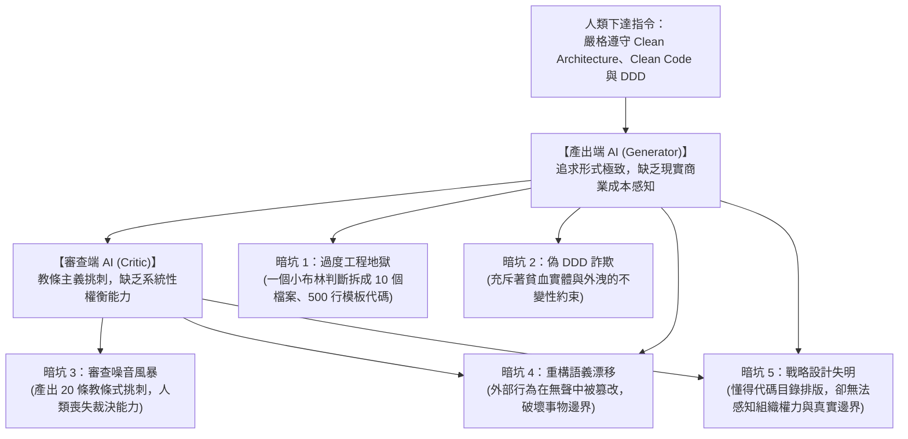
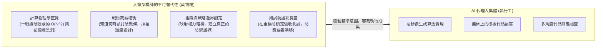

# AI 時代的代碼基本功：算法、Clean Code 與 DDD 的終極暗坑與裁判權

> **「當代碼的生產成本趨近於零時，審查成本與架構失控的代價卻呈指數級暴增。把專有名詞丟給 AI 很簡單，但要在雙代理人互審的嘈雜噪音中做出正確的生死裁決，靠的依然是架構師深入骨髓的底層法理。」**

---

## 一、 現實迷思：將經典心法當作 Prompt 魔法的幻想

在大型語言模型（LLM）與自動化代碼代理人（Agentic Coding）普及的時代，工程師面對空白檔案手打代碼的場景急劇減少。業界開始浮現一種極具誘惑力的思潮：

> *「既然 AI 敲幾秒鐘就能產出完整代碼，那我只要在 `AGENTS.md` 明確規定遵守 Clean Code、Clean Architecture 與 DDD；產出代碼後，再叫第二個 Reviewer AI 拿著這些標準進行交叉審核，我再決定要不要修。這樣一來，我根本不需要深入去學算法、整潔代碼或領域架構，把這些專有名詞當作 Prompt 咒語交給 AI 自產自檢不就好了嗎？」*

這種**「雙代理人互審（Actor-Critic Pattern）」**在工程形式上完全成立，但如果身為駕駛者的人類自己沒有通透這些經典底層，這套玩法將在表面極度光鮮整潔的假象下，把整套系統引向萬劫不復的深淵。

---

## 二、 底層剖析：雙 AI 互審下的五大致命暗坑

當一個不具備架構法理心智的人，試圖讓 AI 替自己落實 Clean Code、Clean Architecture 與 DDD 時，必然會遭遇以下五個隱蔽而致命的技術暗坑：

### 1. 形式主義的過度工程地獄（Enterprise FizzBuzz）
* **現象**：AI 沒有軟體生命週期與維護成本的概念。當你要求「嚴格 Clean Architecture」，一個只需 3 行代碼的 VIP 狀態查詢，AI 會鉅細靡遺地產出：`UserEntity`、`VipStatusVo`、`UseCase` 介面、`UseCaseImpl` 實作、`Port` 出站介面、`Adapter` 適配器、三種 `DTO/PO/VO` 與 `Mapper`。
* **代價**：原本純粹的商業邏輯被淹沒在 10 個檔案與 500 行的樣板代碼中。系統的偶然複雜度（Accidental Complexity）暴增 10 倍，AI 未來的上下文視窗（Context Window）全被無意義的物件轉換代碼吃光。

### 2. 掛羊頭賣狗肉的「偽 DDD」（精神分裂的貧血模型）
* **現象**：AI 產出的所謂 DDD，95% 只是**「套上了領域資料夾名稱的傳統三層式貧血架構」**。實體（Entity）裡只有 `@Getter` 和 `@Setter`，業務規則與不變性約束（Invariants）依然被平鋪直敘地塞在 `ApplicationService` 裡寫成數百行的腳本。
* **審查同源盲區**：審查 AI 掃描目錄：*「有 Entity、有 Repository，命名符合標準，審核通過！」* 缺乏底層辨識力的人，會誤以為自己真的擁有了領域高內聚，實則交易邊界門戶大開，併發資料隨時可能被污染。

### 3. 教條主義的審查噪音風暴（失去裁決權的魁儡法官）
* **現象**：當 Reviewer AI 嚴格扮演 Clean Code 警察時，它會針對細枝末節展開無休止的教條挑刺：*「這個方法有 6 行建議拆成 3 行」、「這裡有 if-else 建議套用策略模式」、「參數超過 2 個建議封裝成物件」*。
* **致命困境**：AI 丟給你 20 條修改建議。**如果你自己不懂架構法理，你根本無從判斷哪一條是精闢的防禦建議，哪一條是書呆子式的過度設計！** 照單全收會讓代碼碎成布屑，隨意忽略則可能放過定時炸彈。

### 4. 重構時的「幽靈級語義漂移（Semantic Drift）」
* **現象**：當你指令 AI 依照整潔原則重構一段混亂代碼時，AI 極易在自作聰明中引入隱蔽的行為變更——把 `<` 改成 `<=`、改變了特定異常的拋出時機、或在無意中將一個本地事務方法抽離至異步執行緒，導致 Spring `@Transactional` 回滾機制失效。
* **代價**：代碼外表變得「乾淨現代」，但業務邊界的正確性已在無聲中瓦解。

### 5. 戰術套版與戰略設計的本質鴻溝
* **現象**：DDD 最核心的價值從來不是「代碼資料夾怎麼擺（戰術設計）」，而是**「世界怎麼劃分（戰略設計：子域劃分、上下文映射 Context Mapping、防腐層策略）」**。
* **代價**：AI 只能分析字面文本，它無法感知組織內部部門間的權力推諉、無法預知未來的跨團隊交接、無法權衡哪些是命脈核心域（Core Domain）哪些是可以容忍技術債的支撐域。

---

## 三、 架構師破局心法：從「代碼打字員」到「最高法院法官」

在 AI 時代，學習經典算法、Clean Code 與 DDD，不再是為了「用自己的手敲出來」，而是為了建立一套**無可替代的「架構裁判權與物理感知直覺」**：

### 1. 算法不是為了手撕，而是為了「兵器辨識與物理直覺」
* **兵器清單 AI 會遞上，挑選的眼力在人**：問題描述清楚，AI 會主動列出布隆過濾器（Bloom Filter）、BitMap 與 `HashSet` 等多種解法。架構師不必憑空想到每一件兵器，但必須看得懂各自的代價，識破「用 `HashSet` 過濾億級資料」這類在當前規模下會打爆記憶體的提案；
* **物理常數 AI 知道，你的量級它不知道**：記憶體訪問（納秒）、磁碟 I/O（微秒）、網路 RPC（毫秒）之間的數量級差距，AI 倒背如流；它缺的是你系統的真實資料量、流量與資源邊界。把情境交給 AI、再以情境裁決方案，才是架構師必須親自把關的物理屏障。

> 這種「從回想轉向辨識」的能力如何養成，詳見 [第六卷第 01 章《AI 時代的學習戰略：從記憶知識到鍛造判斷力》](../06-架構師職涯戰略與生存術/01-AI時代的學習戰略：從記憶知識到鍛造判斷力.md)。

### 2. 架構師的「戰術裁減藝術」
* 成熟架構師的標誌，不在於能把系統搞得多複雜，而在於**「有勇氣在該簡單的地方保持極簡」**；
* 清楚界定何時該用貧血模型的快速 CRUD（如報表查詢、邊緣維護），何時才需要動用充血聚合根保護核心金流。對 Reviewer AI 的挑刺，能果斷地說「不」。

### 3. 測試防護網先行（Test Harness First）
* 永遠不要在沒有自動化測試網的前提下讓 AI 重構代碼；
* 真正的重構心法，是**先逼 AI 根據既有行為產出覆蓋極限邊界的字元化測試（Characterization Tests）**，確認測試全綠後，才下達重構指令。

---

## 四、 核心總結 (Key Takeaways)

1. **AI 擅長局部求解，人類負責全域秩序**：  
   AI 可以在一微秒內產出最優代碼，但它永遠無法替代架構師在「業務價值、物理極限、組織博弈」之間做出權衡。
2. **專有名詞是咒語，但法理在人心中**：  
   直接把 Clean Architecture 或 DDD 丟給 AI，換來的通常是臃腫的「形式主義垃圾」或掛羊頭賣狗肉的「偽 DDD」。
3. **終極的組織責任論**：  
   生產環境崩潰時，任何法官都不會接受「是 AI 說代碼沒問題」的辯詞。**懂算法、懂架構、懂重構的人，才具備在技術風暴中做出最後裁決並力挽狂瀾的真正威望！**
