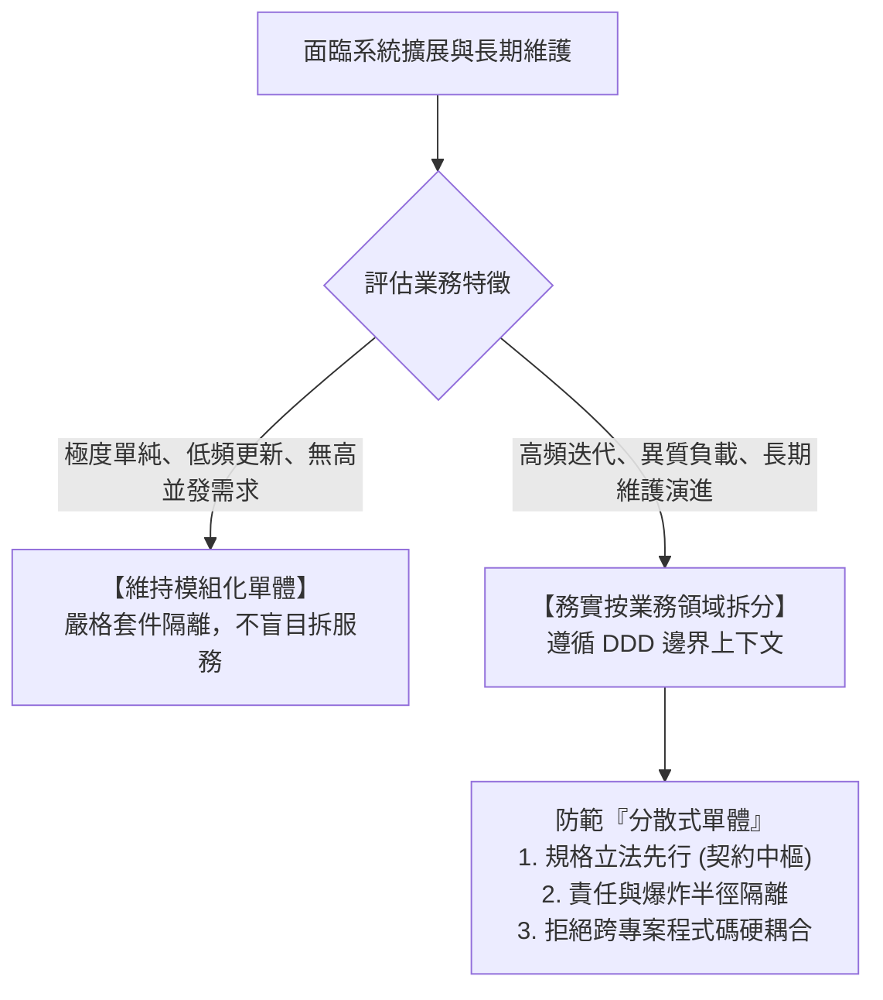

# 單體與微服務的真假辯證：戳破「老單體烏托邦」迷思與防範「簡歷驅動開發」災難

> **「在軟體工程中，最危險的兩種極端：一種是盲目崇拜老舊單體的『歲月靜好』，另一種是為了個人履歷而肢解系統的『微服務狂熱』。」**

---

## 一、 網路爆紅的「單體神話」寓言

在技術社群與匿名論壇上，每隔一段時間就會流傳一篇類似情節的諷刺爽文：

> *「某間科技公司有一套內部管理系統，已經運作了十五年。這套系統使用傳統的單體式架構（Monolithic Architecture），前端是網頁，後端是一個應用程式，資料全部存在同一個關聯式資料庫。系統介面雖然老舊，但運作非常穩定，員工登入一秒鐘，查詢兩秒鐘，報表最多三秒鐘。*  
> *結果新來的高薪空降主管，嫌棄單體落後，強行推動微服務重構，引入 K8s、Kafka、分散式資料庫。兩年過去，耗資數千萬，系統登入變成十五秒，動輒服務超時崩潰。最後主管在履歷寫上『成功主導微服務轉型』跳槽外商高就，基層工程師則在火海中收拾殘局……」*

這類文章之所以引發廣泛共鳴，是因為它精準踩中了廣大一線工程師的集體創傷。然而，身為具備全局視野的架構師，我們必須冷靜地剖析這篇文章的**真實性**與**欺騙性**。

---

## 二、 戳破謊言：「十五年老單體烏托邦」是巨大的倖存者偏差

文章中將「十五年老單體」描繪成一個廉價、穩定、高效的世外桃源，這在現實世界的商業開發中，絕大多數只是一個**美化過的童話**。

### 1. 「運作穩定」背後的真相是「業務停滯」
老單體之所以穩定不當機，往往不是因為架構設計多麼精妙，而是因為**這套系統所服務的業務已經多年沒有實質性變化**。如果業務不需要每週迭代、不需要承受節慶行銷的百倍流量衝擊、不需要頻繁對接第三方異質系統，那麼單體確實能安靜地躺在單一伺服器上運轉。但這絕非常態商業競爭下的真實場景。

### 2. 業務創新被架構綁架
在真實的企業中，十五年單體往往演變成了「不敢碰的祖傳屎山（Big Ball of Mud）」：
* 業務團隊提出一個新的促銷機制或會員等級方案，技術團隊評估後的回覆往往是：「這個改動會影響單體核心底層，風險極高，需要排期半年。」
* 表面上的穩定，是以**「徹底扼殺業務創新與市場敏捷度」**為代價換來的。

### 3. 老臣的黑箱防禦要塞
老單體往往成為少數資深員工的「免死金牌」。系統內部沉澱了無數缺乏文檔的邊界邏輯、硬編碼魔法數字與潛規則。新人進來難以理解、不敢改動，老臣靠著資訊不對稱與技術黑箱築起權力壁壘，對團隊梯隊建設形成極大的阻礙。

---

## 三、 肯定真實：「簡歷驅動開發（RDD）」的權力割韭菜

雖然文章將單體過度美化，但它對微服務災難的批判卻是**無比真實的職場寫照**。這種災難的核心根源並不在於「微服務」這項技術，而在於背後醜陋的組織政治：

### 1. 空降管理者的政治績效困境
新官上任三把火，空降主管必須在一年內向老闆與投資人證明自己的高薪價值：
* 如果他維持老單體修修補補，他的工作就顯得平凡無奇；
* 如果他喊出「微服務轉型、雲原生重構、DDD 落地」，這是一面光芒四射的旗幟，能向上爭取龐大預算、向下重整團隊權力。

### 2. 收益個人化，風險外部化
* **高管的收益在前期**：爭取到預算、招攬了更多人手、在技術大會上演講、在個人的 LinkedIn 和履歷上添上亮眼的一筆（Resume-Driven Development, RDD）。
* **團隊的代價在後期**：當微服務拆分缺乏嚴密的領域邊界劃分、缺乏合約治理中樞（Contract Governance）時，系統會迅速退化為最糟糕的**「分散式單體（Distributed Monolith）」**——擁有了分散式系統所有的延遲、網路不穩定、分散式事務困難，卻依然保留了單體互相耦合的束縛。
* 當災難全面爆發時，主管早已拿著漂亮的「改革戰功」跳槽到下一家公司，把半夜爬起來看監控報警、處理死信佇列的苦難全部留給基層工程師。

---

## 四、 核心辯證：架構師的理性選擇

既然老單體是死路，為炫技而拆的微服務是地獄，那架構師的正確出路在哪裡？

### 1. 拆分的本質是「領域自治」，而非「技術炫技」
真正成熟的拆分，不是為了用 Spring Cloud 或 K8s，而是因為**不同業務領域的演進速率與負載特性完全不同**：
* 核心交易鏈路需要極致的穩定性與低延遲；
* 促銷與遊戲鏈路需要極高的頻繁變更能力與彈性；
* 報表與日誌計算屬於批次計算密集型。
若混在一起，只會互相牽制、彼此拖垮。

### 2. 「寧可按業務範圍拆分」的智慧
面對長期更新的功能，寧可承受早期的拆分成本，也不要在單體中越陷越深。拆分的關鍵在於：
* **界定上下文（Bounded Context）**：依據真實商業能力切分，而非依技術層次亂切；
* **爆炸半徑控制（Blast Radius）**：即使一個領域崩潰，絕不波及全平台的命脈；
* **契約與立法約束**：藉由清晰的資料規格與溝通協定，維繫分散式架構下的頂層秩序。
