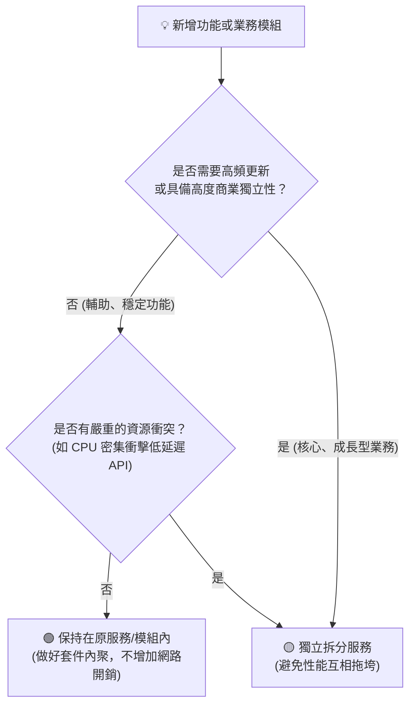

# 務實拆分法則：按業務領域切割而非技術炫技

> **「拆分不是為了彰顯技術有多先進，而是為了讓複雜的業務能夠以最小的認知摩擦各自獨立演進。」**

---

## 一、 迷思：拆分是技術問題還是業務問題？

在工程界，很多團隊在評估是否要拆分系統時，往往聚焦在技術指標：
* 「我們的程式碼已經達到五萬行了，是不是該拆了？」
* 「我們要引入微服務與 Docker 容器化，是不是該拆成十幾個小服務？」

這種以「技術形式」為導向的拆分，往往是悲劇的開始。真正的架構師明白：**拆分本質上是「業務生命週期與演進速率」的權衡問題，而非技術代碼量的問題。**

---

## 二、 務實拆分的黃金評估矩陣（Decision Matrix）

何時該堅定拆分？何時應就地維持單體/模組化？可以透過以下四個維度來審查：

| 評估維度 | 維持在單體/模組內 (Monolith) | 果斷獨立拆分 (Split Service) |
| :--- | :--- | :--- |
| **業務變更頻率** | 低頻、穩定、規則數年不變 | 高頻迭代、每週都有新規則與新需求 |
| **工作負載特徵** | 與既有模組同量級、同屬 I/O 密集 | 異質負載（如：CPU 密集計算衝擊 I/O 低延遲） |
| **擴展性要求** | 整體流量平穩，無需彈性擴展 | 存在突發流量（如秒殺、行銷活動、即時遊戲） |
| **組織維護邊界** | 單一小團隊內部即可全權掌控 | 跨團隊協同、由不同業務條線主導 |

---

## 三、 防範「分散式單體」的三大鐵律

當你決定按業務領域拆分時，最危險的陷阱就是把系統做成了**「分散式單體（Distributed Monolith）」**——表面上有很多個獨立進程，實際上牽一髮動全身。

要保證拆分後的純粹與健康，必須恪守三項鐵律：

### 1. 嚴禁資料庫共享（Database-per-Service）
* 如果服務 A 與服務 B 拆開了，但後端依然連向同一個 MySQL 資料庫，並在 SQL 裡互相 Join 對方的資料表，這不是微服務，這是**最慢的單體**；
* 領域拆分必須伴隨著**資料自治**：各自擁有獨立的儲存實例或邏輯庫，跨服務資料查詢一律透過契約 API 或非同步事件傳輸。

### 2. 嚴格規格立法先行（Contract-First）
* 服務拆分後，網路成為新的不穩定因素。介面定義（JSON Schema / Event Payload）必須先於編碼定稿；
* 契約一旦發布，必須遵循「只增不減」與向後相容原則，禁止未經協商的突發變更。

### 3. 非同步優於同步（Asynchronous First）
* 盡量減少跨服務的長鏈條 HTTP 同步調用（A 叫 B，B 叫 C，C 叫 D）；
* 對於非即時強一致性需求（如日誌收集、成就更新、報表計算），果斷採用**訊息佇列（Message Queue）**解耦，確保調用鏈路不會因為單一點的延遲而全線崩潰。
