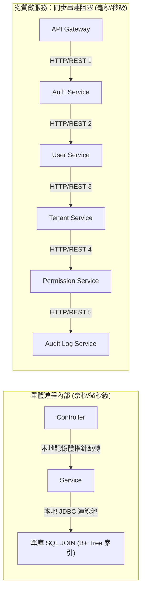
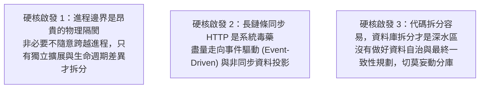

# 老單體 vs. 微服務的硬核技術覆盤：物理延遲、序列化稅與分散式陷阱

> **「進程內調用是微秒級的記憶體指針跳轉，而跨進程調用是不可控的網路 I/O。當你跨越物理進程邊界時，你必須為每一次呼叫支付序列化稅、網路延遲與分散式治理的昂貴代價。」**

---

## 一、 案例背景回顧

在業界廣泛流傳的技術警世短文中，經常出現以下極端對比：
* **老單體系統**：運行 15 年，單體應用 + 單一關聯式資料庫，登入 1 秒、查詢 2 秒、報表 3 秒，架構簡單且極其穩定。
* **重構後的微服務**：耗時 2 年、導入 K8s、Kafka、分散式資料庫，結果登入暴增至 15 秒、頻繁逾時崩潰、雲端帳單飆升 10~20 倍。

若拋開職場政治與情感偏好，純粹從**底層作業系統、網路傳輸、資料庫引擎與分散式架構的硬核技術角度**來看，這篇故事有哪些符合物理規律的「真實」，又有哪些違背工程常識的「誇大與迷思」？

---

## 二、 技術上「完全合理」的物理與工程規律

文章中描述的微服務延遲暴增與基礎設施成本飆升，在技術底層是有真實物理與架構依據的：

### 1. 進程內調用 vs. 網路傳輸的數量級差距（SerDe Tax 序列化稅）
* **單體的方法調用（In-Process Method Call）**：  
  Controller 調用 Service、Service 調用 DAO，本質上純粹是 CPU 暫存器操作與記憶體堆疊（Stack）指針的位移，耗時在**奈秒（Nanoseconds）至微秒（Microseconds）**級別。不產生任何網路封包、不經歷序列化（Serialization）與反序列化（Deserialization），吞吐量只受限於 CPU 與記憶體頻寬。
* **微服務的 RPC / HTTP 開銷**：  
  每一次跨進程通訊，資料都必須經歷：`Java 物件 ➔ JSON/Protobuf 二進位編碼 ➔ 核心 TCP 緩衝區 ➔ 網卡驅動 ➔ 實體交換機 ➔ 目標網卡 ➔ 核心解包 ➔ 反序列化為 Java 物件`。即使在千兆/萬兆內網環境下，一次單向網路傳輸加上兩端序列化開銷，基礎延遲通常在 1~5ms 之間。若未經優化，跨越 5~6 個服務的鏈路將白白耗費數十毫秒純通訊成本。

### 2. 「登入從 1 秒變 15 秒」的成因：同步阻塞與木桶效應（Cascading Latency）
這在初學或欠缺架構治理的微服務專案中極為常見，工程師往往犯了**「把本地方法調用 1:1 照搬成 HTTP 介面」**的致命錯誤：
* **單體時代**：登入驗證只需一條簡單的 SQL 查主鍵或索引：`SELECT * FROM users WHERE username = ?`，驗證密碼 Hash，100ms 內完成。
* **劣質微服務時代**：登入操作被拆分成同步長鏈條：
  1. API Gateway 收到請求，呼叫 `Auth-Service` 驗證權杖；
  2. `Auth-Service` 同步呼叫 `User-Service` 獲取用戶基礎資料；
  3. `User-Service` 同步呼叫 `Tenant-Service` 驗證租戶與授權狀態；
  4. `Tenant-Service` 同步呼叫 `Permission-Service` 構建權限樹狀結構；
  5. 最後同步呼叫 `Audit-Service` 記錄審計日誌。
* **木桶效應與排隊理論**：若其中任何一個下游服務遭遇高負載、連線池耗盡或 JVM 垃圾回收（Stop-the-world GC）停頓 2 秒，整條鏈路的線程將集體阻塞等待，進而耗盡上游 API Gateway 的線程池，最終演變為 504 Gateway Timeout 或 15 秒以上的超長延遲。

### 3. 雲端帳單暴增 10~20 倍：無法迴避的基礎設施稅
單體架構只需一至兩台高規格主機。而完整的微服務架構會引入巨額的「非業務基礎設施開銷」：
* **容器平台控制面（K8s Control Plane）**：API Server、etcd、Controller Manager、Kubelet、CNI 網路插件，吃掉可觀的底層算力；
* **高可用冗餘成本**：即使是極低流量的小服務，為避免單點故障（SPOF），每個服務也至少需部署 2~3 個 Pod 實例。50 個微服務意味著 100~150 個容器進程；
* **可觀測性資源黑洞（Observability Overhead）**：Prometheus 指標採集、Loki/Elasticsearch 分散式日誌彙整、OpenTelemetry/Jaeger 全鏈路追蹤，監控系統本身的儲存與運算開銷，常超越業務服務本身；
* **網路流量費刺客**：在公有雲環境中，跨可用區（Cross-AZ）的內部網路流量與 NAT Gateway 資料處理費，隨著微服務節點間頻繁的 RPC 通訊呈現指數級增長。

---

## 三、 技術上「極不合理」的小說化誇大與迷思

文章為了營造諷刺的反差效果，在技術層面隱瞞了老單體的致命弱點，並將極度低劣的架構實踐扣在微服務頭上：

### 1. 「老單體的單一關聯式 DB 跑 15 年始終高效」是違背數據常理的神話
* **資料重力與慢查詢穿透（Data Gravity）**：一個營運 15 年的內部系統，核心交易表、操作日誌、單據明細的資料量必然膨脹至數千萬甚至上億級別。在未做分庫分表、冷熱數據分離與歷史歸檔的前提下，「報表產生最多 3 秒」極不現實。
* **鎖競爭與連線池耗盡**：關聯式資料庫（如 MySQL InnoDB）的單庫連線池與 Buffer Pool 是有限資源。單體中隨意一個未建立覆蓋索引的報表查詢，觸發全表掃描（Full Table Scan）並鎖定資料列或引發磁碟 I/O 飆升至 100%，將直接導致在線交易的 Connection 取得超時，整座系統瞬時陷入假死。

### 2. 忽略了老舊技術棧的「技術腐化（Bit Rot）與安全死鎖」
* 15 年前的單體應用（約 2011 年架構）往往依賴過時的 Java 6/7、Struts 2 或早期的 Spring 框架。
* **依賴地獄（Dependency Hell）**：若遭遇重大遠端代碼執行漏洞（如 Log4j、Fastjson 等已知 CVE），由於單體內部代碼高度緊密耦合，升級單一庫往往引發全站數百個編譯錯誤，陷入「無法打補丁、無法重構」的技術死鎖。
* **缺乏現代低延遲調優手段**：無法無縫受惠於現代 JVM 的超低延遲垃圾回收器（ZGC、Shenandoah）與虛擬執行緒（Virtual Threads）。

### 3. 「微服務必然頻繁崩潰」是對現代架構工程的扭曲
真正由具備分散式經驗的架構師落地的微服務體系，具備完備的防護機制：
* **身份認證無狀態化**：現代微服務登入絕不走 5 層同步 RPC，而是使用無狀態 JWT 或邊界 Redis 快取。API Gateway 在 2ms 內即可完成權杖解析，後續請求直接在 Header 傳遞身份上下文，內部零查庫。
* **CQRS 與資料投影（Materialized View）**：面對高負載報表與複雜統計，合格的架構採用「命令查詢職責分離（CQRS）」，日常透過非同步事件（MQ）將各領域資料投影至專為查詢設計的儲存（如 Elasticsearch 或 ClickHouse）。點擊報表是直接讀取扁平化結果，速度與穩定度遠勝單庫的大表關聯（Multi-table JOIN）。
* **隔離與熔斷保護**：配置嚴格的連線超時、斷路器（Circuit Breaker）與執行緒池隔離，任何單一下游服務發生抖動或故障，自動觸發降級回退（Fallback），絕不連鎖波及整個系統。

---

## 四、 架構師的硬核技術總結（Key Takeaways）

1. **進程邊界不是物件導向的套件目錄**：  
   跨進程調用不是免費的。切分微服務必須以「業務演進獨立性」、「不同資源特性（CPU 密集 vs. I/O 密集）」為依據，而不是把小模組盲目拆成碎片。
2. **非同步優於同步**：  
   微服務的大忌是把 REST API 當成 Java Method Call 來串聯。長鏈條同步呼叫必然導致延遲累積與雪崩；非同步訊息（Message Queue）解耦與物化視圖，才是分散式架構保持低延遲與高吞吐的基石。
3. **電商血淚經驗的真實價值**：  
   你在電商（EC）中體會到的「高並發擊穿單體資料庫、垂直堆算力遭遇 JVM 天花板、多表關聯牽一髮動全身」，是關聯式資料庫與單一進程的客觀物理極限。**基於業務領域拆分（DDD Bounded Context）、落實資料自治、並以中樞規格立法約束，是超越極端單體與劣質微服務的唯一理性道路。**
