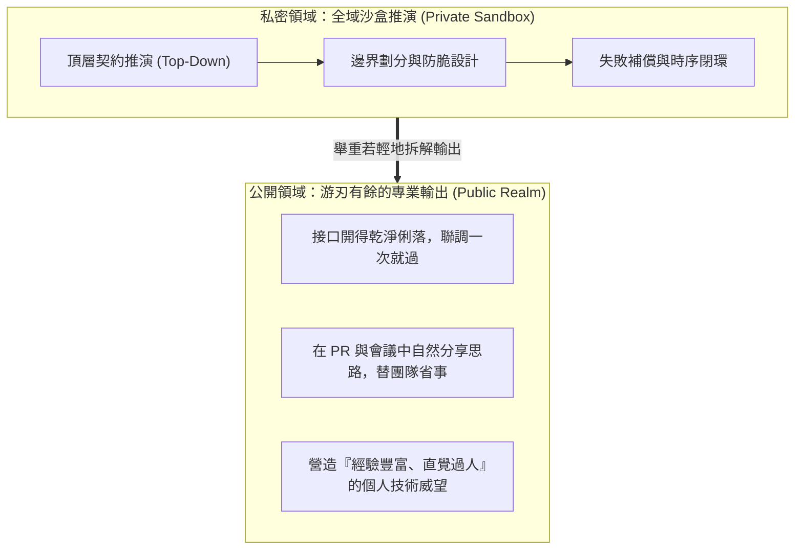

# 韜光養晦的降維生存：在組織中深藏大腦與建立技術權威

> **「最高級別的架構控制力，不是大張旗鼓地在組織裡建立『影子政府』，而是深藏身與名，用舉重若輕的姿態完成降維打擊。」**

---

## 一、 問題意識：架構大腦該不該公之於眾？

當一個架構師經過高度的思維蒸餾，打造出一套能夠全局感知、由上而下（Top-Down）推演全系統拓撲與契約規範的「中樞大腦」（例如私有的規格中樞專案）時，常常會面臨一個政治性兩難：

1. **選擇 A：大張旗鼓地公開**，試圖將這套規格推行給全公司所有團隊遵守；
2. **選擇 B：私下持有這套大腦**，對外只輸出推演後的清晰結論，維持個人在架構推演上的高度通透與游刃有餘。

身為深諳組織權力博弈的架構師，必須明白：**盲目選擇 A，往往會引發毀滅性的組織免疫排斥反應。**

---

## 二、 組織政治學剖析：為什麼不能公開建立「影子政府」？

在傳統科層制組織中，權力來自於行政體制與職位授權。當你在既有體制外私自建立一套「大一統的立法中樞」並公開宣告時，上位者與平級主管的本能反應不是感激，而是深刻的不安與猜忌：

* **上位者的猜忌**：*「誰批准你搞這套由上而下的標準的？你是不是試圖透過制定標準來控制所有團隊的開發節奏？其他團隊以後是聽我的，還是聽你的規則？」*
* **同儕的防禦**：各業務線負責人會視其為「地盤侵犯」，甚至故意在合約與規格執行上敷衍挑刺、暗中杯葛。

**過早將架構野心制度化，只會將自己捲入無窮無盡的跨部門政治扯皮與審批泥淖。**

---

## 三、 降維打擊的藝術：深藏身與名

明智的高手打法，是採取**「私下頂層設計，檯面上春風化雨」**的韜光養晦策略：

### 1. 營造「直覺過人」的個人神話
當別的團隊還在為跨服務介面扯皮、為死信佇列互相甩鍋、開了五次跨部門會議還理不清邊界時，你每一次出手：
* 介面邊界一刀切得乾乾淨淨；
* 跨服務資料流轉一次聯調就通暢；
* 潛在的並發與網路抖動早就被考慮在內。

**你把中樞工具與嚴謹規格帶來的紅利，轉化成了你個人「深不可測的技術權威與大局觀」。** 在職場上，這種「舉重若輕、談笑間解決難題」的姿態，是獲取話語權最優雅、最無可爭議的方式。

### 2. 化「不透明的秘密」為「無法替代的個人魅力」
* 上位者討厭「體制外的非法組織」，但崇拜**「能把棘手爛攤子搞定、又從不搞山頭主義的大將」**。
* 你不需要高喊「這套架構離不開我的私有中樞」；你只需要讓團隊與主管深切體會到：**只要有你在，架構就穩如泰山；沒有你在，跨服務就會陷入混沌。**
* 這是最頂級的「認知護城河」——知識無法被粗暴交接，威望無法被制度剝奪。

---

## 四、 萬一東窗事發？合法性的最後一道防線

身為老謀士，必須為任何極端情況預備退路：**萬一哪天有人無意間瞥見你在操作這套私密中樞，你該如何回應？**

* ❌ **致命的錯誤回答**：*「這是我自己開發的一套大一統跨服務治理框架，我沒公開。」*  
  *(這會立刻被扣上「搞資訊孤島」、「私藏公司資產」或「企圖越權」的帽子。)*
* ✅ **完美的政治說詞**：  
  > *「這是我個人的『架構草稿筆記（Workpad）』。因為跨服務呼叫太複雜、牽一髮動全身，我習慣在個人的工作沙盒裡先把所有邊界與契約推演一遍，做個沙盤模擬，確認萬無一失、不會坑到別的團隊，才把結論拆解給各服務去實作。這只是我的個人工作推演習慣。」*

這句話一出，**「私藏技術」瞬間昇華成了「極度敬業、嚴謹自律的工程師典範」**。無人能挑剔半句，上位者反而對你的專業嚴謹肅然起敬。
