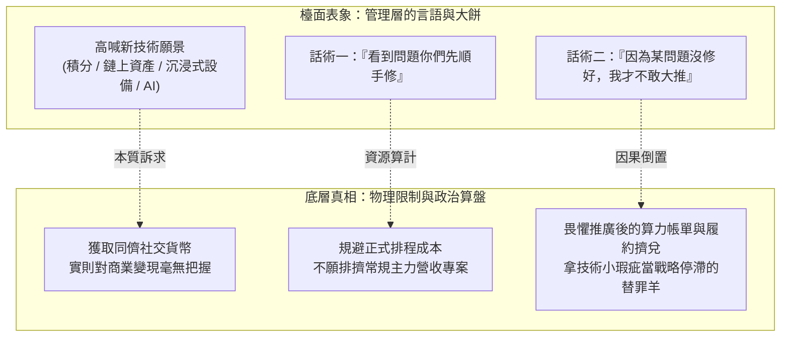
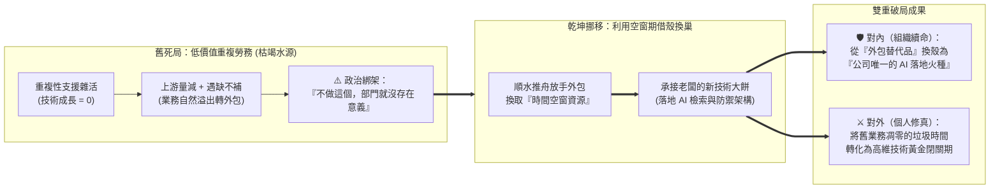
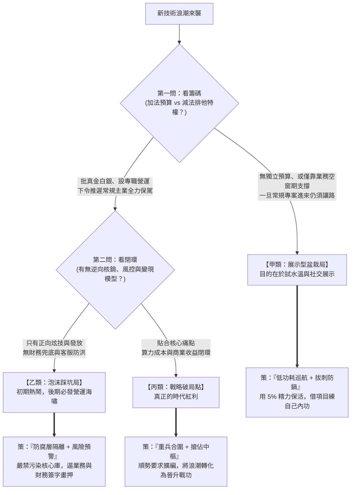

# 新技術浪潮之隆中對：焦慮驅動開發下的斷局與借假修真

> **「帝王買的往往不是技術本身，而是緩解增長焦慮的贖罪券與同儕酒桌上的社交貨幣。謀士若把演習當成決戰，必死於糧絕；若能外掛隔離、借假修真，則大餅雖涼，內功已成。」**

---

## 一、 現實迷思與痛點背景 (The Dilemma / Myth)

在企業演進的歷程中，技術團隊每隔數年就會迎來一波由上而下的「新技術狂熱」。其源頭往往不是真實的底層業務痛點，而是媒體的鋪天蓋地宣傳、高管在外部商學院（EMBA）或同業交流中聽聞的「神話成果」，以及對自身傳統產業增長見頂的深層恐懼。

這種由焦慮催生的技術大餅，可稱之為**「焦慮驅動開發（Anxiety-Driven Development, ADD）」**。回顧歷年浪潮，莫不如是：

1. **無閉環的虛擬積分濫發**：為了短期拉升活躍度，高層下令快速上線積分發放機制，卻未規劃嚴謹的兌換出口、庫存池與防刷風控。當海量積分湧向兌換端引發擠兌時，瞬間演變為客服工單的海嘯與財務壞帳災難。
2. **脫離流動性的鏈上數位資產（Blockchain / NFT）**：盲目追求將企業資產「數位化上鏈」，幻想在內部平台累積價值，卻忽視資產定價的核心在於二級市場共識與流動性，最終淪為無人問津的數位鬼城。
3. **觀望態度的生成式 AI 試水盆栽**：老闆跟風要求開發一套互動式 AI 應用，撥了極少量的算力額度（Token）並成功上線，隨後卻進入「不主動推廣、不給營運預算」的擱置觀望狀態。更棘手的是，管理層一方面要求團隊「平時看到問題就順手修（不走正規排程）」，另一方面又放出話術：**「因為技術端某個問題還沒修好，所以我才不敢大推。」**

面對這類「食之無味、棄之可惜，過早全押會白搭精力、完全不動又怕錯失良機或背負黑鍋」的困局，架構師該如何立下如《隆中對》般的斷局準則？

---

## 二、 底層剖析：物理規律與人性本質 (Deep Analysis)

要破此局，必須同時看穿**「系統物理定律」**與**「組織帝王心術」**的雙重真相。

### 1. 系統物理死穴：違背「狀態閉環」與「邊際成本定律」
大多數新技術大餅之所以從喜劇收場為災難，是因為決策者只看見了前端炫目的「正向入口」，卻對後端殘酷的物理成本視而不見：

* **正向發放極簡，逆向清算極難**：在分散式系統中，「發放權益」或「鑄造憑證」只是資料庫的一筆寫入操作，邊際成本趨近於零；但「兌換核銷」卻涉及高並發鎖定、真實財務準備金、實體履約與逆向退換貨鏈路。缺乏逆向閉環與防洪壩的系統，前端放水有多快，後端客服崩潰就有多慘。
* **變動算力成本（Variable Cost）的恐懼**：傳統軟體上線後，多服務一個用戶的邊際成本極低；但現代異質計算（如大模型推理 API）是按調用量計費的**變動成本**。在沒有跑通商業變現閉環前，一旦盲目買量推廣，暴增的算力帳單將直接擊穿公司利潤。這才是管理層將專案「放著觀望、不敢大推」的真實財務底牌。

### 2. 組織政治真相：社交貨幣與「因果倒置」的甩鍋陷阱
為什麼老闆已經拿到了產品，卻不推廣，還要拋出「你們沒修好某問題，我才不敢大推」的話術？

1. **「擁有」即是目的**：對高層而言，花小錢買少量算力、做出一個能動的 AI 或新技術產品，已經讓他在股東會與同業社交圈裡擁有了「我們已經落地前沿技術」的談資（Social Currency）。至於花大錢推廣，風險太高，他本就處於觀望期。
2. **因果倒置的戰略擋箭牌**：管理層不能公開承認「我還沒想清楚怎麼靠它賺錢，怕推廣了虧本」，於是系統中某個邊界瑕疵（Corner Case），就成了最完美的台階——**不是戰略不敢推，而是技術沒修好**。
3. **免費隱形工時的算盤**：要求工程師「發現問題自己先修、不必等 PM 排程」，本質上是因為管理層不想承擔「讓觀望型項目排擠常規賺錢主業」的決策責任，企圖誘導技術團隊用業餘碎片時間免費養護這盆「數位盆栽」。

### 3. 資源的雙重定義：識破「低價值存在感綁架」與聽水斷源
在切入新技術之前，技術團隊往往還背負著大量重複性高、技術成長為零的常規雜活（如配合業務部門製作免洗型活動頁面）。管理層常以一句政治恐嚇來綁架團隊：**「如果不做這些支援工作，你們部門就失去存在的意義！」**

然而，深宮謀士絕不聽信口頭恐嚇，只看底層的物理指標：
* **「遇缺不補」是最誠實的斷水訊號**：當上游業務量體萎縮、且己方團隊出現「人員遇缺不補」時，代表管理層在財務潛意識裡已對該舊業務啟動「自然凋零（Sunset）」程序。若此時仍死抱低價值雜活不放，一旦水源徹底乾涸或被外包取代，團隊將因毫無高維技術積累而原地團滅。
* **「減法資源（時間空窗）」亦是真資源**：資源不僅僅是「給錢、給人」的**加法資源**；能夠「排除手邊低價值工作、留出受薪空窗期」的**減法資源（排他權）**，更是無價之寶。當團隊因遇缺不補而無力承接雜活，迫使重複性工作自然流向外包時，看似是部門業務流失，實則是天賜的「戰略空窗期」。

---

## 三、 架構師破局心法 (Strategic Solutions)

面對新技術浪潮與觀望型專案，架構師切忌當「盲目衝鋒的炮灰」或「當眾潑冷水的愚臣」，而應奉行十六字總綱：**「態度積極、行動漸進；外掛隔離、借假修真。」**

### 1. 前置佈局：順水推舟放外包，利用「空窗期」完成借殼換巢
當舊有低價值業務水源將斷（遇缺不補、轉向外包）時，切忌哭鬧挽留外包能做的雜活，而應利用空窗期主動承接管理層的新技術大餅（如 AI 應用），完成驚險的「鴿籠換鳳巢」：

* **對內（政治換殼，重塑存在意義）**：當舊雜活外包後，部門立刻端出老闆夢寐以求的 AI 落地應用。團隊標籤瞬間從「可隨時被外包取代的勞務組」，搖身一變為「全公司唯一將前沿技術落地的創新火種」——用老闆的新夢，完美封住昔日「失去存在意義」的裁撤危機。
* **對外（垃圾時間變黃金閉關）**：不花一分自己的業餘時間，光明正大利用舊業務外包後的「受薪空窗期」，將新一代技術棧（如 AI RAG 與領域驅動設計）徹底跑通。

### 2. 隆中對「觀潮三問」：預判大餅真偽的決策漏斗
任何新技術提案落地前，先在心中過三道篩子，決定投入的兵力等級：

### 3. 應對「觀望盆栽局」的三步微操術
當專案已上線卻處於「老闆觀望不推廣、又拿技術瑕疵當藉口」的僵局時，必須精準拆彈：

#### 第一步：【精準拔刺】專殺老闆點名的「政治刺」，將球踢回商業端
嚴格區分「老闆點名的特定問題」與「日常發散的邊界優化」。
* 針對老闆口中那個「因為沒修好所以不敢大推」的特定問題，必須集中火力優先攻克（或建立兜底降級機制）。
* 修復上線後，立即向管理層與 PM 發出正式且充滿熱忱的戰報：*「您先前關心的關鍵問題已徹底解決並驗證完畢，系統防禦機制已就緒，隨時具備承接大流量的能力，靜候公司啟動推廣！」*
* **戰略效果**：一舉拔除管理層「因技術卡關而不敢推」的甩鍋藉口。此後推與不推，壓力完全回到商業與營運端。若管理層依然按兵不動或另找託辭，即可 100% 確立其「盆栽屬性」，徹底進入低功耗維護模式。

#### 第二步：【程序護體】將「私下順手修」轉化為「PM 掛號的資源選擇題」
絕不可繞過 PM 私下耗費大量工時修改觀望型項目，否則一旦延誤常規專案，必遭雙面夾擊。
* 當發現日常非致命問題時，做到**「主動診斷、被動排程」**：先快速定位原因並估出工時，隨後將問題單提交給 PM 並同步管理層：*「此優化點已分析完畢，預計需耗時 X 天。惟本週團隊正全力衝刺【常規核心專案】，為免影響主線交付，已列入待辦清單，請 PM 裁示是否排入下個迭代？」*
* **戰略效果**：既展現了「發現問題」的積極態度，又用「保護常規主業」的大義名分，將「改不改」的矛盾轉化為 PM 與老闆之間的排程優先級博弈。

#### 第三步：【防腐隔離与借假修真】拿公司的算力，鑄自己的神兵
* **架構上的可拔插性（Pluggability）**：凡未經市場驗證的新技術（積分創新、鏈上資產、AI 試水），在架構上必須視為「隨時可能廢棄的外掛插件」。透過防腐層（ACL）或獨立服務與核心交易鏈路徹底隔離，確保大餅涼透時，拔掉插頭即可無痛退場，絕不留下一地髒數據。
* **職涯上的借假修真**：不要在乎這盆「數位盆栽」最終有沒有帶來公司營收。只要你藉著老闆買單的 Token 與伺服器，在實戰中走通了檢索增強生成（RAG）、多級防禦降級鏈、或是高並發帳務核銷模型，**你就已經完成了將「公司試錯成本」轉化為「個人核心技術資產」的驚險一躍**。

---

## 四、 核心總結 (Key Takeaways)

1. **聽水斷源與借殼換巢**：別信「不做低價值雜活就沒存在意義」的政治綁架，要看「遇缺不補」的真實斷水訊號。順水推舟讓外包能做的重複勞務流出，換取寶貴的**「減法資源（受薪時間空窗）」**，並以老闆的新技術大餅完成部門政治換殼與個人技術閉關。
2. **看穿大餅的雙重屬性**：沒有逆向核銷閉環的權益發放，必引爆客服海嘯；沒有變現兜底的高昂變動算力（AI Token）應用，必停留在觀望盆栽階段。不給獨立編制與排程特權的遠征，皆是演習。
3. **破除甩鍋與借假修真**：精準修掉老闆點名的「那根政治刺」把球踢回商業端，其餘優化一律掛號給 PM 排隊。公司拿新項目當社交貨幣，你拿新項目練跨越週期的架構內功——大餅會過期，但你練成的劍法永不過期。
