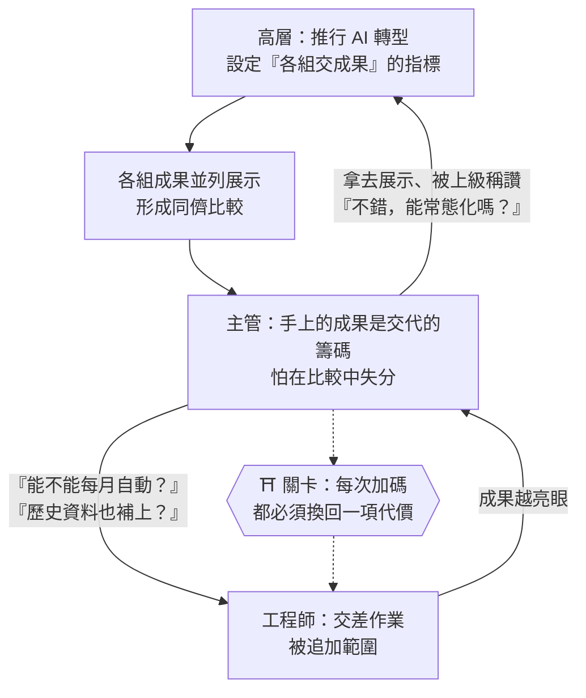
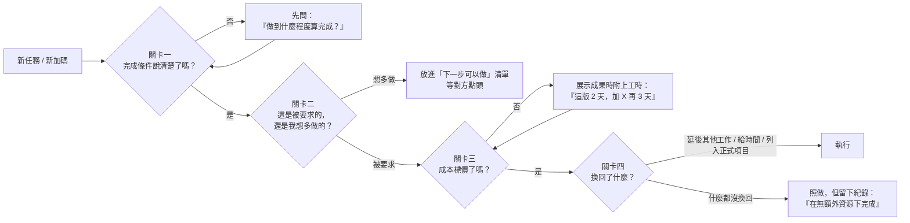

# 交差作業的雪球效應：範圍蠕變下的關卡設計與體面退場

> **「應付之作一旦被端上檯面，就不再屬於你，而屬於看過它的每一個人。謀士不必猜透人心，只需在每一次加碼處設關收稅；默默爛尾是失職，依數據下架才是退場。」**

---

## 一、 現實迷思與痛點背景 (The Dilemma / Myth)

公司由上而下推行 AI，下令各組「每組至少交出一個 AI 小工具」。這類運動式任務，起點幾乎都是應付：沒有預算、沒有排程、沒有驗收標準，只有一個期限。

工程師的理性選擇，是挑最快能出成果的題目：拿手邊現成的使用行為數據，匯出一份，交給 AI 跑一份分析報表。半天完工，作業交差。

劇情接著走向熟悉的方向：

1. **第一次加碼**：「能不能每個月自動產出？」
2. **第二次加碼**：「年初到現在的資料也一起呈現，看得出趨勢。」
3. **定性升級**：「我們單位有工程師，做不成一個工具說不過去。」

不知不覺間，一份交差作業被推成了正式專案，卻依然沒有預算、沒有排程、沒有人說清楚「做到哪裡算完成」。

此時工程師的心裡通常會冒出兩種歸因，與兩種應對：

* **歸因一**：「是不是我做得太好，讓主管產生了幻想？」——於是後悔，下次決定刻意做差。
* **歸因二**：「主管是不是本來就想把事情做大，我被下套了？」——於是心生防備，與主管的關係開始轉冷。
* **應對一：默默爛尾**。展示當天撐過去，之後不再更新，「反正應該沒人看」。
* **應對二：全力承接**。把它當成正式產品做，從此多了一件沒有編制、甩不掉的永久雜務。

本篇要回答的核心問題是：**當一件應付性任務被組織壓力推升為正式專案時，如何在不必猜透人心、也不得罪人的前提下，設下關卡、控制投入，並為它保留一個體面的結局？**

---

## 二、 底層剖析：物理規律與人性本質 (Deep Analysis)

### 1. 壓力傳導鏈：主管往往也是被推的那一個

運動式任務的升級，很少源自某個人的陰謀，而是**壓力沿著層級傳導**的結構現象：

這條鏈有一個自我強化的迴路：工程師交出的成果越好，主管越有東西可展示；展示越成功，上級的期待越高；期待越高，壓力就越原封不動地回到工程師身上。

### 2. 三種歸因的辨識：從語氣判讀，不從動機猜測

| 情況 | 典型訊號 | 判讀 |
| :--- | :--- | :--- |
| **甲：成果墊高了期待** | 加碼發生在看見成果之後，句型是「既然能做到這樣，那也可以……」 | 常見，但通常不是全部原因 |
| **乙：蓄意做局** | 一開始刻意輕描淡寫，之後按計畫逐步加碼；早已知道這是要往上呈報的項目 | 少見。設局需要預謀，這與主管起初同樣想應付交差互相矛盾 |
| **丙：被往上推** | 加碼時點恰好落在各組交件、上級過目、或別組展示更亮眼之後；語氣是「說不過去」 | **最常見** |

判讀的關鍵在語氣。**「做不成一個工具說不過去」是防衛句，不是藍圖句**——說話的人擔心的是在比較中失分，而不是對工具懷有願景。這是被往上推的人典型的語言。

最便宜的驗證方式是直接問，但用「對齊方向」的口吻問：「這個工具上面有什麼特別的期待嗎？我想確認方向做對了。」既不質疑動機，又能探知事情是否已被上級盯上。

### 3. 成本隱形化：AI 時代的期望棘輪

在 AI 普及之前，「做出一份分析報表」需要數天，成本肉眼可見。今天它只需要半天，旁觀者看到的是「AI 做的，所以不費工」。

這產生了一個**只會上升、不會下降的期望棘輪（Ratchet）**：

* **主動多做的部分，在他人眼中成本為零**。你順手加的趨勢圖、順手補的歷史月份，會立刻成為下一次的基本配備。
* **成本不說出口，就沒有人替你計算**。對方的腦中沒有「這花了兩天」的帳，只有「上次很快就好了」的印象。

所以「我做太好」這個歸因只對了一半：**問題不在做好，而在做多，且沒有標價。**

### 4. 爛尾的物理真相：荒廢是無聲的，事故是突然的

「展示完就不更新，反正沒人看」這個策略，有三個被低估的失效模式：

1. **沉默不等於沒人用**。多數讀者看報表不會回信，直到某天發現它停了，才來問「怎麼沒有了」。此時工程師的處境是「被發現停掉」，而不是「決定停掉」。
2. **過期數字會被引用**。報表一旦被轉寄，裡面的數字就會脫離原始脈絡，被貼進某份簡報、某個決策。追查錯誤時，源頭指向的是產出它的人。
3. **警語在複製時消失**。在報表上加註「本分析由 AI 生成，僅供參考」是必要的，但它保護不了你——被複製出去的永遠是數字與結論，不是警語。

還有一個最容易被忽略的耦合點：**資料本身**。手動匯出雖然不牽動任何系統，但使用行為數據往往屬於個人資料。它被存放在個人電腦、交給外部 AI 服務處理，這件事是否符合公司的 AI 使用規範？運動式任務的指派者很少想到這一層，而一旦出事，責任落在執行者身上，而不是指派者。

---

## 三、 架構師破局心法 (Strategic Solutions)

### 1. 不必猜心：一套關卡，同時防住三種情況

最重要的認知轉換是：**你不需要先判斷主管是甲、乙、還是丙**。同一套關卡機制對三種情況都有效：

* 若是**甲**，關卡讓主管看見成本，期待自然收斂。
* 若是**乙**，關卡讓每一步加碼都留下紀錄，對方無法無償地一路累積。
* 若是**丙**，關卡給了主管向上交代的素材——「這件事需要 X 資源」——反而幫了他。

把問題從「他是不是在算計我」轉換成「這裡缺了什麼關卡」，就從人心博弈回到了結構設計，這正是架構師的主場。

### 2. 四道關卡：讓範圍的每一次擴張都有代價

* **關卡一：先問完成條件**。接下任何小任務時多問一句「做到什麼程度算完成？」。有了明確的完成條件，之後的加碼就成了「新需求」，而不是「本來就該做的」。
* **關卡二：做好，不做多**。品質是名聲，不必打折；但只做被要求的範圍。想到的延伸功能，列在清單上而不是先做出來——列在清單上的東西，需要對方點頭，點頭就要付出代價。
* **關卡三：成果必附標價**。每次展示都說出工時與下一步的成本。這是對抗期望棘輪唯一有效的方法。
* **關卡四：加碼換資源**。資源不只是加法（給人、給錢），也包含減法（允許延後其他工作）。不需要對抗，只需把選擇題遞回去：「可以，那手上的 X 要延後一週，可以嗎？」

### 3. 在籌碼最多時開口：展示之前，問兩個問題

開口要資源的最佳時機，是**主管最需要你交出成果的時候**，也就是展示之前。展示之後再談，性質就從「確認範圍」變成了「討價還價」。

兩個問題，一兩分鐘講完：

1. **「這份報表主要給誰看？我想依使用者的需要調整內容。」**
   主管若說得出具體的使用單位或人，就代表有真實閉環；若說不出來，你心裡就有了答案，而且這個答案是主管親口給的。這比事後統計三個月的回信數更快、更準。
2. **「這件事大約需要 N 天，手上的 X 是否可以延後，或您希望哪個優先？」**
   主管同意延後，你就拿到了減法資源；他說兩個都要，你也留下了紀錄。

### 4. 架構上的護身符：把「錯不得」與「可容錯」分開

即使只打算低成本維持，有三件事不能省：

* **數字由確定性程式計算，AI 只負責解讀文字**。計數、排名、成長率是錯不得的那一半，絕不交給生成式模型；AI 寫的解讀即使平庸，也不會產生錯誤的事實。這是報表被轉寄、被引用時唯一可靠的防線。
* **資料先去識別化，再交給 AI**。將可識別個人的欄位遮蔽或雜湊，或只餵入彙總後的統計值。這一步在展示時還能轉化為亮點：「資料先去識別化，再交給 AI 分析。」
* **對「自動化」的承諾必須誠實**。若實際流程是「每月手動匯出、一個指令產出報表」，就如實說「一鍵產出」，不要說成全自動排程。被追問時答得出來的說法，才是安全的說法。

### 5. 體面退場：把「爛尾」改寫成「依數據下架」

退場與爛尾的結果相同——都是不再更新——但責任歸屬與名聲完全不同：

* **預設退場條款**：展示時就說好：「三個月後看使用情況，沒人用就暫停；有人用，就由使用單位提需求。」
* **留下使用證據**：記錄收件人、回饋、詢問次數。停止時有數據可依，而不是憑感覺。
* **主動告知，不默默停止**：一句話即可——「這份報表三個月來沒有回饋，我打算先暫停，有需要隨時恢復。」

這一步把「工程師做了一半就丟」改寫成「工程師依據使用數據做出了下架決策」。前者是失職，後者是治理。

### 6. 一個提醒：勿將結構問題人格化

把升級解讀為「被下套」，最大的代價不在這一次任務，而在關係。你的防備主管感受得到；關係轉冷之後，下一次落到你頭上的，就不會是一個可以低成本應付的 AI 小工具，而是更難推掉的東西。

把它當成結構問題處理：壓力自上而下傳導，你在傳導鏈的末端設好關卡。主管有東西交代，你有邊界可守，雙方都不吃虧。

---

## 四、 核心總結 (Key Takeaways)

1. **不必猜心，只需設關**：範圍蠕變多半是壓力沿層級傳導的結構現象，而非個人陰謀。「先問完成條件、做好不做多、成果必附標價、加碼換資源」四道關卡，無論對方是無心、有意還是被推，都同樣有效。
2. **在籌碼最多時開口**：展示之前問清「給誰看」與「什麼可以延後」，前者直接驗證閉環是否存在，後者把資源取捨變成主管的決定。過了展示，同樣的問題就成了討價還價。
3. **爛尾與下架，結果相同、責任相反**：數字交給程式、資料先去識別化，守住錯不得的那一半；再以預設的退場條款與使用數據，主動宣告暫停。默默荒廢會在無聲處引爆，依數據下架則是一次乾淨的治理決策。
