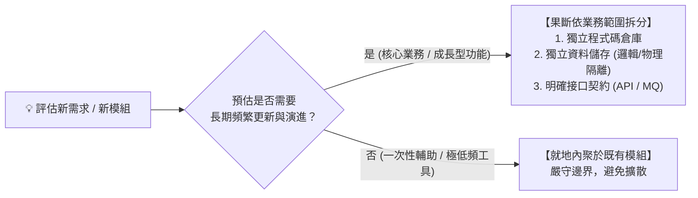

# 電商（EC）高並發卡死教訓：垂直堆算力的極限與業務擴展困局

> **「在單體架構中，當流量與複雜度同步爆發時，垂直堆砌算力就像試圖給一輛牛車裝上噴射引擎——代價極其高昂，且隨時會散架。」**

---

## 一、 背景與困局：未拆分單體的蜜月期與破滅

在電子商務（EC）系統開發的初期，單體架構（Monolith）展現出了無可比擬的開發效率：
* 一套專案代碼、一個關聯式資料庫、本機可以直接啟動；
* 會員、商品、購物車、促銷折扣、訂單、庫存、支付全部在同一個進程內呼叫，開發直觀、交易控制簡單（單一 `@Transactional` 搞定一切）。

然而，這段蜜月期在業務迎來高速成長、促銷活動與高並發流量湧入時，迅速變成了無法醒來的噩夢。

---

## 二、 核心痛點：三大卡死維度

### 1. 資源競爭與瓶頸連坐（Blast Radius 失控）
在電商場景中，不同模組的流量與運算特徵具有天壤之別：
* **商品瀏覽**：高頻讀取、讀多寫少，極度依賴快取；
* **秒殺促銷**：突發性超高並發寫入、熱點庫存扣減；
* **報表統計與帳務結算**：大量歷史資料的大表關聯（Join）與批次聚合，極度消耗 CPU 與磁碟 I/O。

當這些功能全部塞在同一套單體與同一個資料庫中時：
* 營運人員在後台匯出一張當月銷售報表，觸發了未優化的慢查詢，導致資料庫連線池（Connection Pool）被耗盡；
* 前端消費者的購物車結帳瞬間集體超時，訂單無法成立；
* **一個非核心邊緣業務的負載失控，直接擊穿了整間公司的命脈金流**。

### 2. 垂直堆算力（Vertical Scaling）的成本黑洞與物理天花板
面對並發瓶頸，單體架構由於無法單獨針對「高負載模組」做擴展，唯一的選擇就是**「整體垂直升級伺服器硬體」**：
* 記憶體從 16G 升到 64G、128G、256G；
* CPU 核心數不斷往上堆，購買價格呈指數級暴增的頂規雲端主機；
* 資料庫買到最高規格的專屬實例。

然而，這種「堆算力」很快就撞上了物理天花板：
* **收益遞減**：Java 虛擬機（JVM）過大的 Heap 記憶體引發了長時間的垃圾回收停頓（Stop-The-World GC），導致系統延遲更加不可預測；
* **單點故障（SPOF）加劇**：主機規格再高，依然是一台伺服器或單一主庫；一旦死鎖或當機，全站瞬間歸零。

### 3. 後期重構拆分的「技術性死鎖」
當意識到必須拆分時，團隊往往發現已經**「拆不動了」**：
* 程式碼層面：十幾萬行代碼中充斥著跨模組的底層 Service 相互注入、循環依賴；
* 資料層面：資料庫中存在大量跨越「商品、訂單、會員、行銷」的多表關聯查詢，外鍵與觸發器交織在一起；
* 商業層面：業務每天都在跑，沒有人能承擔「停機重構半年」的商業代價。
系統陷入了**「不拆等死、想拆找死」**的終極僵局。

---

## 三、 血淚總結：架構師的防禦守則

從電商戰場的死人堆裡爬出來後，提煉出這條永不妥協的架構心法：

### 1. 預估長期更新者，寧可提前按業務範圍拆分
只要評估該功能屬於「核心業務流程」或「未來會高頻演進」，就**絕不貪圖前期的省事而塞入單體大泥球**。
就算初始團隊規模不大、就算不是教科書式的嚴格微服務，也**至少必須在業務邊界、資料儲存與進程邊界上做出物理切分**。

### 2. 前期微小的拆分成本，是對沖後期災難的廉價保險
* 提前拆分需要額外定義 API 契約、處理網路序列化與日誌追蹤，初期看起來多花了一兩天時間；
* 但比起後期面臨「全站連坐崩潰、無法水平擴展、拆分卡死」的數月甚至數年浩劫，這點成本是全天下回報率最高的防禦性投資。
