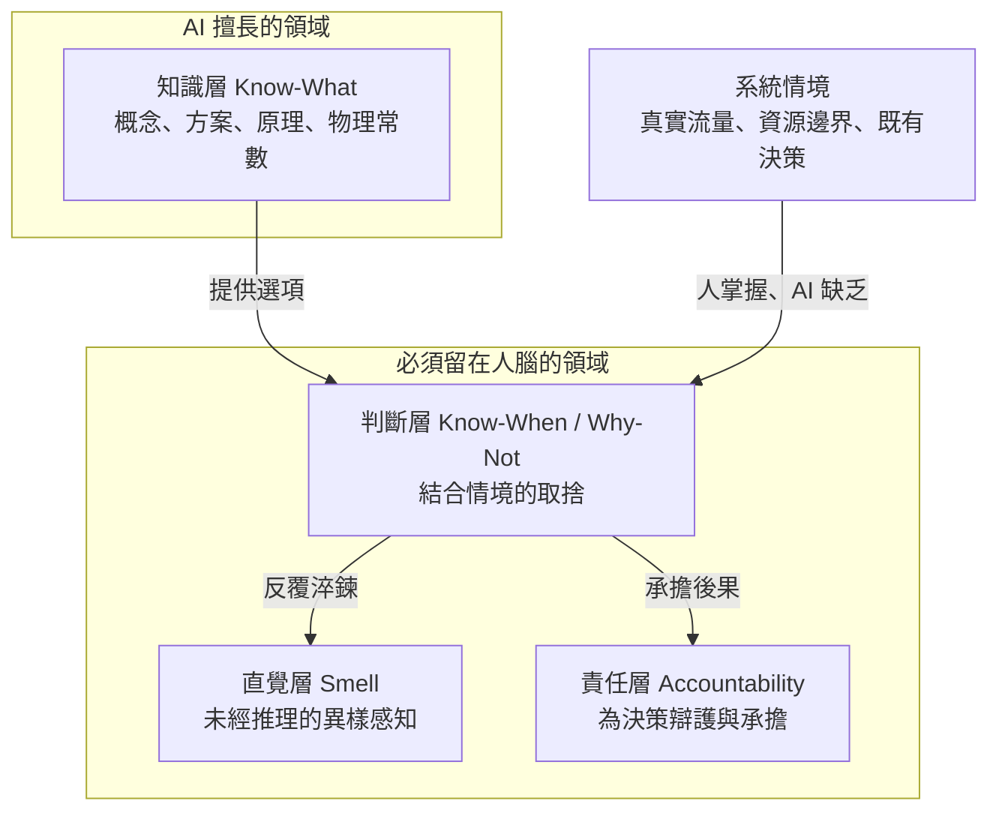
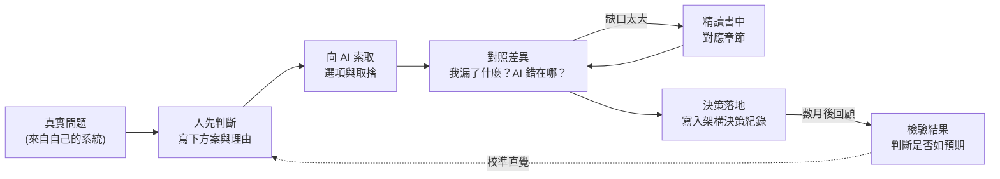

# AI 時代的學習戰略：從記憶知識到鍛造判斷力

> **「當知識可以隨問隨得，腦袋裡真正值錢的，不再是記住了多少，而是能否在 AI 遞上的十個方案中，認出那個會在你的系統裡爆炸的一個。」**

---

## 一、 現實迷思與痛點背景 (The Dilemma / Myth)

一位資深工程師在與 AI 協作開發的過程中，萌生了一個看似理所當然的念頭：

> *「把我過去讀過的技術書籍——高流量架構、算法、重構——逐本整理成知識點交給 AI，以後討論設計時，它就能站在這些經典之上給我建議。」*

AI 的回應是否決：書中的通用知識，模型早已具備，整理成書摘不會讓建議更準。真正讓建議失準的，是 AI 不知道的東西——系統的真實流量、團隊的維運邊界、已經拍板的架構決策。缺了這些，AI 只能給出「教科書平均解」，例如在資料量遠未觸頂時就建議分庫分表。

這個否決引出一個更尖銳的問題：

* 如果 AI 不需要書單，**人還需要讀書嗎？**
* 如果仍需要，**讀書的目的與方式，是否也該隨之改變？**
* 書本是否仍是不可替代的學習載體，還是可以被其他來源取代？

兩種極端都很危險：一端是「AI 什麼都知道，我不必再學」的放棄論；另一端是「照舊從第一頁讀到最後一頁、背下所有方案」的慣性論。前者讓人喪失審判 AI 的能力，後者把最稀缺的時間花在 AI 最擅長的事情上。

---

## 二、 底層剖析：AI 拿走了哪一層，又留下了哪一層 (Deep Analysis)

### 1. 「學習」不是單一能力，而是四個層次

| 層次 | 本質 | 例子 | AI 的衝擊 |
| :--- | :--- | :--- | :--- |
| **知識（Know-What）** | 概念與方案的存在與原理 | 令牌桶如何限流、布隆過濾器的誤判特性 | **大幅取代**：隨問隨得 |
| **判斷（Know-When / Why-Not）** | 在特定情境下取捨 | 「這個量級還不需要分表」 | **無法取代**：判斷必須結合情境 |
| **直覺（Smell）** | 未經推理即察覺異樣 | 一眼看出某個設計會在流量高峰時鎖死 | **無法取代**：來自大量接觸與踩坑 |
| **責任（Accountability）** | 為決策辯護並承擔後果 | 事故檢討會上說明當初為何如此設計 | **無法取代**：組織只追究人 |

過去的技術書籍同時服務這四層，而人們習慣以「記住多少知識」來衡量讀書成效。AI 拿走的恰恰是第一層，**於是讀書的價值重心，必須從第一層移往後三層。**

### 2. 瓶頸轉移：從「想得到」到「判得對」

過去，架構師必須「心中有兵器」——不知道布隆過濾器存在的人，永遠不會用它。如今，只要問題描述清楚，AI 會主動列出布隆過濾器、BitMap、雜湊集合等多種解法。**人不再需要憑空想到每一件兵器，但必須看得懂每一件兵器的代價，並識破那個在當前規模下會爆炸的提案。**

這裡存在一個關鍵的不對稱：

* **辨識（Recognition）遠比回想（Recall）便宜**：讀懂一個方案的取捨，比從零設計出它容易得多。這是 AI 時代學習效率可以大幅提升的根本原因。
* **但辨識絕非零成本**：一個從未理解過的概念，你無法判斷 AI 對它的運用是否正確。審判權的門檻降低了，卻沒有消失。

### 3. 流暢錯覺：AI 時代最隱蔽的學習陷阱

AI 的解釋永遠條理分明、語氣篤定。讀完一段 AI 摘要，人會產生「我懂了」的感覺，這就是認知心理學所說的**流暢錯覺（Fluency Illusion）**——把「讀起來很順」誤認為「已經掌握」。

被動閱讀 AI 產出的內容，與被動閱讀書本並無二致，甚至更糟：書本至少逼你花時間與作者的論證搏鬥，AI 則把所有摩擦都替你磨平了。**沒有摩擦，就沒有判斷力的生長。**

### 4. 書本的獨特價值：一張你不知道自己需要的地圖

AI 是問答式的，它只回答你想得到的問題；而判斷力最大的漏洞，往往藏在**「不知道自己不知道」（Unknown Unknowns）**的地方。書本的價值在於：作者替你決定了知識的結構，逼你走過那些你從未想過要問的路徑。

然而，並非每本書都值得這樣對待。不同類型的書，在 AI 時代的價值天差地別：

| 書籍類型 | 代表 | 核心價值 | 建議讀法 |
| :--- | :--- | :--- | :--- |
| **思想型** | 重構、領域驅動設計、整潔架構 | 判斷的框架，變化緩慢 | **完整精讀，累積實戰經驗後重讀**；每次重讀都會讀出新的取捨 |
| **方案型** | 高流量系統解決方案類 | 方案目錄與作者的實戰經驗 | **讀目錄建立地圖，遇到問題再讀對應章節**；技術細節交給 AI |
| **練功型** | 算法競賽類 | 解題技巧與程式能力 | **對架構師投報率低**；需要的是複雜度直覺與資料結構取捨清單，除非目標是面試或純粹享受解題 |

---

## 三、 架構師破局心法 (Strategic Solutions)

### 1. 學習閉環：先判斷，再對答案，最後看結果

有效的學習必須保留「摩擦」。以下閉環的關鍵，在於人必須在看到 AI 答案**之前**，先寫下自己的判斷：

* **先判斷再看答案**：本質是一場自我測驗。只看 AI 的答案，永遠是觀眾；先下判斷再對照，才是選手。
* **讓 AI 反過來詰問你**：要求 AI 扮演質疑者，追問設計中的每一個假設。被問倒的地方，就是該去翻書的地方。
* **架構決策紀錄（ADR）即教材**：記錄「當時為什麼這樣決定」，數月後回頭檢驗。這是唯一一本完全基於你自身情境的教科書，也是直覺得以校準的回饋迴路。

### 2. 多元來源，各司其職

書本不是唯一的學習載體，但每種來源都有它的盲區：

| 來源 | 擅長 | 盲區 |
| :--- | :--- | :--- |
| **書本** | 完整地圖、一致的思想體系、作者的經驗 | 慢；充斥填充內容；技術細節會過時 |
| **AI 對話** | 針對個人問題、即時、可無限追問 | 只回答你問的；流暢卻可能錯；缺乏你的情境 |
| **自身系統**（事故、監控、決策紀錄） | 最真實的情境與回饋 | 範圍受限於你碰過的問題 |
| **事故覆盤與工程部落格** | 真實的失敗代價 | 零散、品質參差 |
| **原始碼閱讀與實驗量測** | 最精確，能建立物理直覺 | 時間成本高 |
| **同儕評審與討論** | 組織情境、多元視角 | 受限於團隊水準 |

一個務實的組合是：**書本提供地圖，AI 擔任陪練，自身系統作為考場，實驗量測校準直覺。**

### 3. 物理直覺來自量測，而非閱讀

延遲數量級、吞吐瓶頸、記憶體佔用——這些數字 AI 都能背出來，但「知道」與「體感」之間隔著一道鴻溝。讓 AI 快速搭建一個用完即棄的原型，親手量測一次快取與資料庫的延遲差距，其效果遠勝讀十頁理論。**AI 大幅降低了實驗的成本，這是過去的學習者所沒有的紅利。**

### 4. 敢於放棄

在時間有限的前提下，「決定不讀什麼」與「決定讀什麼」同等重要。練功型書籍若不服務於當前目標，大方擱置；方案型書籍讀完目錄即可上架備查。把精讀的時間，留給那幾本會隨著經驗增長而越讀越深的思想型經典。

---

## 四、 核心總結 (Key Takeaways)

1. **AI 拿走了記憶，留下了判斷**：  
   讀書的目的，從「把知識放進腦袋」轉向「建立能審判 AI 方案的判斷力」。知識隨問隨得，判斷力只能在「先判斷、再對照、後檢驗」的閉環中鍛造。
2. **辨識比回想便宜，但不是免費**：  
   架構師不必再憑空想到每一件兵器，但必須看得懂每件兵器的代價；從未理解過的東西，你無法審判。
3. **書本是地圖，不是倉庫**：  
   思想型經典值得反覆精讀，方案型書籍讀目錄備查，練功型書籍視目標取捨。真正的教科書，是你自己系統裡的決策紀錄與事故覆盤。

---

> **前篇**：[第一卷第 02 章《AI 時代的代碼基本功：算法、Clean Code 與 DDD 的終極暗坑與裁判權》](../01-架構哲學與高維抽象/02-AI時代的代碼基本功：算法、Clean與DDD的終極暗坑與裁判權.md)——前者論證「為什麼人必須保有裁判權」，本章回答「裁判權如何養成」。
>
> **附錄**：[個人書單分類與閱讀策略](./附錄-個人書單分類與閱讀策略.md)——將本章的三類書籍讀法套用到實際書單。
