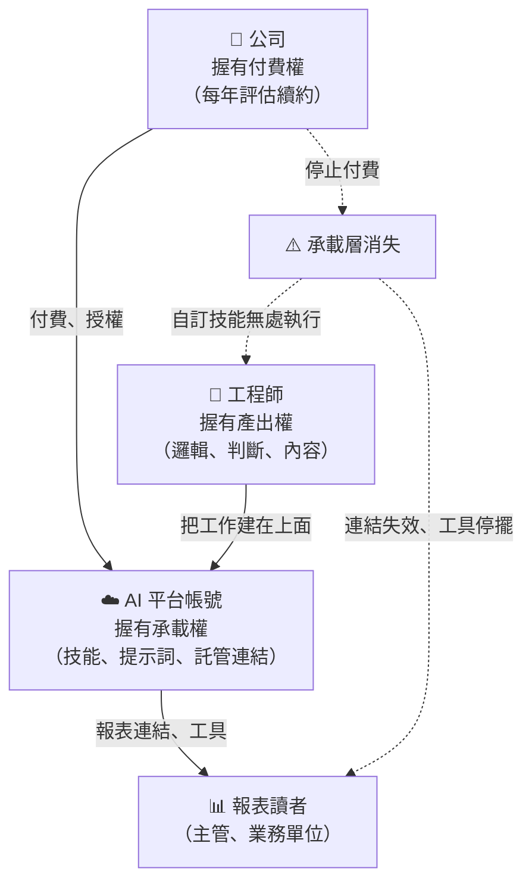
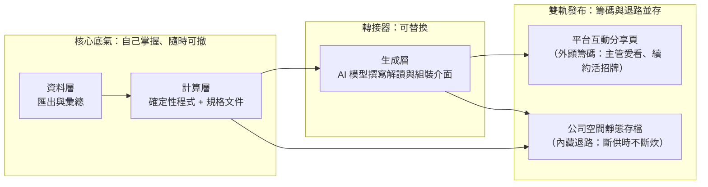

# 租來的兵器：AI 平台綁定下的資產歸屬與可替換設計

> **「兵器是租來的，劍法是自己的。不怕被綁定，只怕被綁住的是自己的筋骨；把可替換的留給平台，把不可替換的握在手中。」**

---

## 一、 現實迷思與痛點背景 (The Dilemma / Myth)

公司為員工開通了 AI 平台的企業帳號，付費、管理、授權都掛在公司名下。工程師一開始只是拿它寫程式、查資料；漸漸地，越來越多東西長在了這個帳號上：

* 為了交差而做的數據分析工具，邏輯寫成了平台上的自訂技能與提示詞；
* 每月產出的報表，以平台託管的分享連結發給主管與業務單位；
* 個人的知識整理、寫作與思考，也在同一個帳號裡完成。

某天，一個念頭浮現：**這個帳號是公司付錢的。一旦公司不再續約，這些工具就全都跑不動了。** 公司與工程師之間，透過一個第三方平台，形成了一種微妙的互相綁定。

面對這個念頭，常見的反應有兩種：

* **無視**：「公司應該會一直付吧。」——把一個每年重新評估的預算項目，當成永久的基礎設施。
* **恐慌**：「那我是不是不該在上面做任何東西？」——因噎廢食，放棄了公司買單的練功機會。

本篇要回答的核心問題是：**當個人的工作產出建立在一個由公司付費、隨時可能被撤銷的 AI 平台上時，什麼東西真正被綁住了？如何讓自己無論公司如何決策，都不被困住？**

---

## 二、 底層剖析：物理規律與人性本質 (Deep Analysis)

### 1. 綁定三角：付費權、承載權與產出權的分離

傳統的工作工具，付費者、使用者、產出的歸屬大致重疊。AI 平台帳號卻把三者拆開了：

這個三角的危險之處在於：**斷點發生在中間層，痛感卻出現在兩端**。公司做出一個財務決策，受影響的是工程師的工具，和讀者手中的連結。而讀者並不知道背後是訂閱終止——他們看到的是「那位工程師做的東西壞了」。

### 2. 分層拆解：真正被綁住的是哪一層

把一個建在 AI 平台上的工具拆開，通常可以看到四層：

| 層次 | 內容 | 可攜性 | 平台消失時 |
| :--- | :--- | :--- | :--- |
| **資料層** | 原始數據的匯出與彙總 | 高——檔案與資料庫本來就在公司內 | 不受影響 |
| **計算層** | 統計口徑、指標定義、計算規則 | **取決於寫在哪裡**——寫成程式與文件則可攜，寫成提示詞則被綁 | 寫在平台上的部分隨之消失 |
| **生成層** | AI 撰寫的解讀與敘述文字 | 高——任何同級模型皆可替代 | 換一個模型即可 |
| **發布層** | 報表的分享連結與託管頁面 | **最低**——綁在個人帳號上 | 所有歷史連結同時失效 |

由此可見兩個反直覺的結論：

* **最容易被替換的，恰恰是 AI 本身**。生成層是整個工具裡最通用的零件，市場上有大量可替代品。
* **真正的風險在計算層與發布層**。計算規則若只存在於提示詞中，平台一撤就失傳；發布連結綁在個人帳號，不只公司停止付費會失效，**工程師調職或離職時同樣會失效**——這已經不只是供應商風險，而是關鍵人風險。

### 3. 公司的決策邏輯：續約不是信仰，是帳本

公司如何決定 AI 平台的去留？這不是技術問題，而是預算週期中的例行審查。常見的評估維度有四個：

1. **用量**：每個帳號的實際使用量。閒置帳號永遠是第一批被裁撤的。
2. **可見產出**：有沒有能拿出來講的成果。運動式推行期間各組交出的小工具，正是續約審查時會被翻出來的證據。
3. **供應商整併**：公司可能決定統一採用某一家企業方案——例如既有辦公套件附帶的 AI 服務。此時的問題不是「砍不砍」，而是「換成哪一家」。
4. **運動的生命週期**：今年的 AI 推行是指標，明年未必是。運動退潮時，預算會跟著收縮。

### 4. 互相綁定的反轉：以顯性產出養隱形兵器

綁定從來不是單向的。公司握有付費權，但工程師心裡往往還有一層更真實的算盤：**這個高階 AI 帳號真正對自己最有價值的，是日常寫程式與深度思考的輔助；但高層審預算時想看的，卻是「導入 AI 做出了什麼業務成果」。**

這兩者之間存在一個「價值可見度」的落差：日常開發與思考的產出是隱形的，很難拿來當作續約報告的亮點；反而是那個原本為了應付交差而做的數據報表與互動展示頁面，是主管與老闆肉眼可見的顯性成果。

換言之，那個跑在帳號上的小工具，實質上是工程師為了保住這把日常神兵所繳納的**「續約投名狀」**。當續約審查來臨，「某某帳號支撐著每月的業務互動報表」是一條具體的保留理由。

但這也帶來一個看似矛盾的命題：**如果要拿工具當保留帳號的籌碼，是不是該讓它跟平台綁得越緊越好？如果要防公司斷供，是不是又該完全解耦？**

破局的關鍵在於分層對待：**在「展示體驗層」盡情發揮平台的便利性（做足續約籌碼），在「計算與資產層」做到隨時可撤換（守住自身底氣）。**

---

## 三、 架構師破局心法 (Strategic Solutions)

總綱十二字：**「外顯便利、內藏底氣；邏輯入庫、正本留存。」**

### 1. 職涯版的埠與轉接器：體驗綁平台，邏輯留手裡

架構上，我們用「埠與轉接器（Ports & Adapters）」把外部依賴隔離在邊界之外。套用到 AI 平台，不是要你放棄平台好用的互動展示與託管分享功能，而是要精準切開「什麼給平台做招牌」與「什麼留給自己做退路」：

* **把「展示層」高調留在平台上當籌碼**：善用平台專屬的互動頁面與託管連結，讓主管與業務讀者習慣「點開連結就能看到精美圖表與解讀」。在公司評估 AI 導入成效時，這個被持續點閱的頁面就是最直觀的續約證據；萬一有人提議砍預算，習慣了這份便利的讀者與主管自然會成為你的同盟。
* **把「計算規則」徹底移出提示詞**：[第三卷第 04 章](../03-組織人文與辦公室政治/04-交差作業的雪球效應：範圍蠕變下的關卡設計與體面退場.md)談過「數字由程式計算」是為了防錯；從資產視角來看，則是為了**防止規則失傳**。寫在平台自訂技能或提示詞裡的業務規則，無法做嚴格的單元測試，只要換一個模型版本就會產生語義漂移。把計數、排名、成長率全部留在本地確定性程式與版控文件中，平台只負責將算好的結構化結果渲染成解讀文字與互動畫面。
* **發布採雙軌制**：對外發送好讀、好看的平台互動連結，同時順手將每期產出的正本（或底層數據與文字）自動留存一份在公司內部空間。公司若續約，皆大歡喜；公司若斷供，你只需半天就能把輸出轉接成靜態網頁或內部文件，毫髮無傷。

### 2. 資產歸屬三分法：分清楚誰的東西放哪裡

| 類別 | 內容 | 應該放在 |
| :--- | :--- | :--- |
| **公司資產** | 工具的計算邏輯、規格文件、每期報表正本 | 公司的程式庫與共用儲存空間——可交接，不隨個人帳號消失 |
| **個人資產** | 判斷力、方法論、知識沉澱 | 自己掌握的可攜格式（純文字、版本控制）——不隨任何平台或雇主消失 |
| **租用能力** | AI 平台的算力與便利功能 | 視為引擎與工具，用完即走，不把唯一的副本存放其中 |

這個分法有兩層意義：

* **對公司負責**：工具的邏輯與正本留在公司，才是真正可交接的交付物。只活在個人帳號上的工具，在公司眼中與「關鍵人綁架」只有一線之隔。
* **對自己負責**：個人的知識資產以可攜格式保存，平台與雇主都可以更換，劍法始終在自己身上。至於用公司付費的工具做個人沉澱是否合宜，應依公司規範自行判斷；但無論如何，可攜格式確保了一旦帳號收回，換成個人訂閱即可無縫接續。

### 3. 斷供演練：每季問自己一次

模仿災難復原演練，定期問一個問題：**「如果明天這個帳號被收回，什麼會壞掉？」**

* 有沒有任何計算規則，只存在於平台上？
* 有沒有任何讀者，手上唯一的報表是一個平台連結？
* 有沒有任何個人知識，只存在於平台的對話紀錄中？

每一個「有」，都是一個尚未拆除的單點故障。

### 4. 觀察續約訊號，而非猜測決策

公司最終的決策無法預測，但訊號可以觀察：

* **合約週期**：知道續約時間點，在審查前把工具的使用證據準備好。
* **用量盤點**：資訊部門開始統計帳號用量，代表審查已經啟動。
* **供應商整併的風聲**：公司開始試用其他 AI 方案，就是啟動「換引擎」準備的時候。
* **運動的溫度**：AI 推行是否仍列在下一年度的指標中。

訊號出現時，因為核心早已可攜，你需要做的只是更換轉接器，而不是搶救資產。

---

## 四、 核心總結 (Key Takeaways)

1. **最容易被替換的是 AI 本身**：工具中真正被綁住的不是生成層，而是寫在提示詞裡的計算規則，與綁在個人帳號上的發布連結。前者會失傳，後者會在公司停止付費、或你調職離職的那一天同時失效。
2. **外顯便利、內藏底氣**：日常寫程式與思考的價值是隱形的，老闆審預算看的是顯性的業務成果。把互動展示留在平台上當「續約投名狀」，同時把計算邏輯入庫、正本留公司——保得住帳號是紅利，保不住也能在半天內無痛換引擎。
3. **兵器是租來的，劍法是自己的**：公司握有付費權，你握有「帳號上跑著實際在用的工具」這張牌。把工具核心做成可交接的公司資產，把判斷力與方法論留成可攜帶的個人資產，去留皆從容。

---

> **前篇**：[第三卷第 04 章《交差作業的雪球效應：範圍蠕變下的關卡設計與體面退場》](../03-組織人文與辦公室政治/04-交差作業的雪球效應：範圍蠕變下的關卡設計與體面退場.md)——前者處理「工具如何被加碼成正式專案」，本章處理「工具建在租來的平台上時，資產該歸誰、放在哪」。
