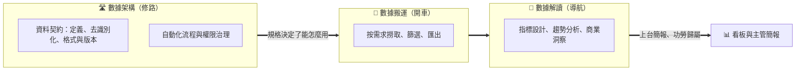
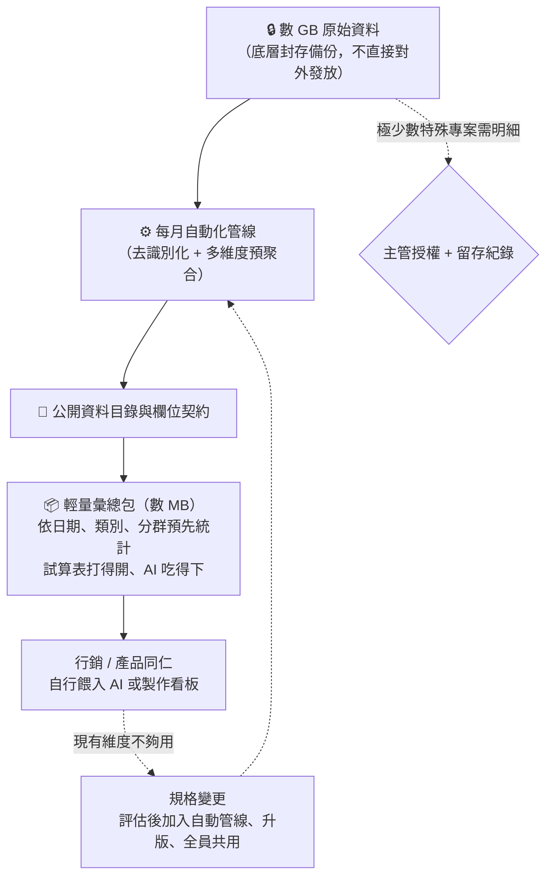

# 修路不開車：數據浪潮中架構師的站位、契約與可見度

> **「搬運者疲於奔命，解讀者各有其主，唯修路者定義了車能怎麼開。架構師不必上台領獎，但路名必須刻著自己的名字。」**

---

## 一、 現實迷思與痛點背景 (The Dilemma / Myth)

公司推行 AI 與數據看板的浪潮中，一位以架構設計與軟體開發為本業的工程師，因為手上握有某項核心業務的用戶行為數據，被主管交辦了一件「沒什麼工作量」的事：

> 「每個月把上個月的資料匯出一份留著，讓行銷、產品的同仁可以自己拿去做其他應用。」

每月數 GB 的明細資料，匯出一次不費多少工夫。主管沒有對外推廣，只是部門內部的應用；但上層的主管們向來偏愛看板，各單位也正被鼓勵「自己用 AI 分析數據」。

工程師隱隱感到不安：這條路走下去，會不會變成整天幫各單位撈數字、出報表？更何況集團早已有專職的數據分析單位。面對這種處境，常見的反應有兩種：

* **往分析靠攏**：「既然資料在我手上，順手把報表和看板也做了吧。」——於是逐月增生的報表需求，慢慢把一位架構師改造成部門的取數窗口。
* **退守 RD 本業**：「數據不是我的工作，我只管寫程式。」——於是在公司最重視數據與 AI 的時刻，主動放棄了資料源頭這個樞紐位置，還可能被貼上「不配合」的標籤。

本篇要回答的核心問題是：**當數據需求找上架構師時，應該站在數據價值鏈的哪一層，才能既不淪為搬運工、也不踩進別人的地盤，同時不在組織中被邊緣化？**

---

## 二、 底層剖析：物理規律與人性本質 (Deep Analysis)

### 1. 數據價值鏈的三種角色

「碰數據」不是一件事，而是三種性質完全不同的工作：

| 角色 | 價值由誰定義 | 工作型態 | 對架構師的意義 |
| :--- | :--- | :--- | :--- |
| **數據搬運** | 提需求的人。做得再好也只是「準時」 | 逐案、無限、可替代 | 低價值的時間黑洞 |
| **數據解讀** | 業務單位與專職分析團隊 | 需要深厚的業務脈絡 | 非本業，且是別人的地盤 |
| **數據架構** | 系統的可靠性、一致性與可交接性 | 一次設計，長期生效 | **正是架構師的本行** |

### 2. 往分析靠攏的四重代價

1. **報表天生會繁殖**：行銷要一版、產品要一版、主管要看板、看板又要細分。每一份都很小，加總起來就是一份全職工作。
2. **評價標準錯位**：架構師的考核看的是系統交付與架構品質。花在報表上的時間不會出現在考核表上，卻會擠壓那些會出現的工作——這是典型的隱形勞動。
3. **解讀需要脈絡，錯誤卻歸咎來源**：「本月行為量為何下滑」的答案藏在活動檔期、內容上架、行銷投放之中。只有數字、沒有脈絡的解讀，錯誤率高，而錯了仍算在產出者頭上。
4. **成為影子分析團隊**：組織既然已有專職的數據分析單位，部門內自行產出分析，在對方眼中就是越界。做得好是搶功，做得差是外行。這與第三卷第 01 章的地盤邏輯、第 02 章「避免建立體制外的影子政府」如出一轍。

### 3. 「每月匯出放著」的雙重陷阱：物理跑不動與權責不對等

即使不主動做報表，只照主管說的「每月匯出幾 GB 原始資料放著讓大家自己用」，依然暗藏兩個結構性陷阱：

* **物理體積的回力鏢（跑不動終究找你）**：行銷與產品人員日常依賴的試算表有明確的行數上限，外部 AI 平台的對話框也有嚴格的檔案大小與上下文限制。數 GB 的原始明細檔交出去，他們連打開都有困難，更別提直接餵給 AI。結果必然是回頭找你：「檔案太大跑不動，能不能先幫我按某某條件篩選或統計好？」——**只要幫切第一次，你就從「每月匯出一次」變成了隨傳隨到的人肉取數機。**
* **資料提供者的權責不對等**：用戶行為明細多半涉及個人資料。當各單位被鼓勵「自己用 AI 分析」，原始檔案一旦外流或被上傳至未受控的外部服務，追查的第一站永遠是「誰匯出的」；但誰能拿、拿去做什麼，提供者卻無權決定也無從管控。

### 4. 基礎建設的宿命：越可靠，越隱形

退守在數據架構層，是正確的站位，但必須正視它的結構性弱點：

* **功勞流向最後一哩**：主管們愛看板，看板出現在誰的簡報裡，功勞就屬於誰。修路的人沒人記得，開車的人上台領獎。
* **運作得越好越看不見**：資料每月準時出現，大家便以為它本來就該在那裡——直到某天斷了，才想起是誰在維護。

所以真正要防的不是「在數據議題上退居幕後」——那是刻意的選擇——而是「在組織裡被看不見」。

---

## 三、 架構師破局心法 (Strategic Solutions)

總綱：**「修路不開車，路名刻自己；給得大方，變得有序。」**

### 1. 分工話術：用「體貼對方跑不動」取代「我不想做」

在需求成形之前，主動與主管對齊分工，並順手拆掉「數 GB 大檔跑不動」的未爆彈：

> 「原始資料一個月好幾 GB，行銷和產品同仁直接開試算表或丟 AI 應該會跑不動。我這邊寫個自動流程，除了把原始檔封存備份之外，每個月自動幫大家壓好一份去識別化、依常用維度統計好的『輕量彙總表』並附上欄位說明，只有幾 MB，他們直接丟 AI 就能做分析。至於後續的指標解讀，就交給使用單位或請集團數據分析單位協助，我把資料品質和自動化管線顧好。」

這段話同時完成四件事：

* 主管聽見的是「你幫大家多想了一步」，而不是「你在推卸」。
* 預先解決了「檔案太大跑不動」的問題，封死日後同仁回頭請你幫忙切資料的後路。
* 點出專職分析單位的存在，讓主管自行衡量部門越界的風險。
* 把自己的角色明確釘在「自動化資料管線」，而非「報表產出」。

### 2. 資料契約：不出報表，卻掌握數字的解釋權

把第一卷「規格立法（Contract-First）」的原則套用到數據領域，資料契約由三個要素構成：

| 要素 | 內容 | 為什麼重要 |
| :--- | :--- | :--- |
| **語意定義** | 每個欄位代表什麼：一次「行為」怎麼算、時長是否扣除閒置、月份以哪個時區切分 | 沒有定義，各單位各自分析，會議上就會出現兩個不同的「本月總量」 |
| **去識別化規則** | 彙總表直接消除個人層級；若需留存明細，用戶識別碼改為雜湊值，姓名、聯絡方式等敏感欄位一律不輸出 | 判斷標準是「分析是否需要」與「外流的風險」，而非留一手 |
| **格式與版本** | 檔案格式、命名、空值表示、分期方式、版本號 | 讓下游的分析流程不會因上游一次無聲的改動而悄悄損壞 |

「規格變更必須經過你」的意思，不是「要資料得經過你批准」，而是**契約的演進要有版本、有通知**——如同系統之間的介面契約：你不管別人怎麼用，但介面長什麼樣子、怎麼變，由你負責。

### 3. 預聚合的輕量資料包：讓工作量與需求數量脫鉤

「誰要什麼就撈什麼」的逐案客製匯出，會讓工作量隨需求者數量線性增長，最終繞回搬運工的老路。正解是**將數 GB 的原始大檔留在底層封存，對外只自動產出少量、固定的輕量標準資料包**：

* **用「預聚合」化解物理瓶頸與資安風險**：把幾 GB 的原始明細透過程式預先壓成幾 MB 的多維度彙總包（例如依日、依功能類別、依年齡層統計）。對使用者而言，檔案變小了才能真正塞進 AI；對你而言，彙總數據天然不含個人敏感資訊，一舉消除了個資外洩的連帶責任。
* **新需求走管線升版，而非單次加撈**：當有人反應「輕量包裡少了一個維度」，一旦通過評估，就修改自動化腳本、升級標準包版本讓所有人共用，絕不為單一需求者做一次性的手工撈取。
* **原始明細嚴守權責分離**：那份數 GB 的原始檔只做封存備份。萬一真有特殊專案非拿明細不可，技術上的去識別化歸你，但「准不准給」的授權判斷一律交回主管，並留下提供紀錄。

如此一來，無論部門內有多少人想拿數據試玩 AI，你每期都是同一套腳本自動跑完，邊際工作量為零。

### 4. 可見度：對內刻下路名，對外不越地盤

退居幕後不等於隱形，但刷存在感時必須拿捏分寸——**要讓直屬主管看見你的工程價值，同時避免高調到讓集團專職數據單位覺得你在搶地盤**：

1. **掌握規格決定權**：欄位定義、去識別化與預聚合規則由你設計，部門內每一份用 AI 跑出來的分析，都建立在你定義的資料契約之上。
2. **讓來源自然留痕**：在資料包隨附的欄位說明文件中註明「資料管線設計與維護者」，並建議同仁在內部看板標註資料來源與版本號。這是標準的工程治理，而非搶功。
3. **向上管理強調「自動化基建」，而非「報表服務」**：在對主管的例行回報中，重點不是「我幫多少人出了報表」（這會招來更多雜務與跨部門忌憚），而是**「已將每月數 GB 無法直接分析的原始資料，建置為全自動、去識別化、AI 可直接讀取的標準資料管線，目前每月零人工干預穩定產出中」**——既展現了架構師把問題自動化解決的高度，也向主管暗示「這條管線已經完工結案，不佔用日常開發產能」。

### 5. 反模式：切勿故意當瓶頸

害怕被邊緣化的人，常會刻意把流程留成只有自己會做，好讓別人離不開。**這是最糟的一步棋**：

* 它把你重新綁回搬運工的位置。
* 「這件事只有他會」遲早會被主管察覺，關鍵人依賴會從籌碼變成扣分項。

正確的方向恰恰相反：自動化、文件化、可交接。**架構師的價值不在「只有我會做」，而在「這套東西是我設計的」**——前者是枷鎖，後者是名聲。

### 6. 漂移警戒線

出現以下任一訊號，就是重新談分工的時候：

* 每期花在報表或臨時取數上的時間，明顯超出例行維運。
* 會議上開始出現「數字問他就好」。
* 有人繞過主管，私下請你撈數字。

---

## 四、 核心總結 (Key Takeaways)

1. **站在修路的那一層**：數據價值鏈上有搬運、解讀、架構三種角色。搬運是時間黑洞，解讀是別人的地盤，唯有數據架構是架構師的本行。守住 RD 的方式不是退出數據，而是把自己釘在基礎建設層。
2. **用預聚合輕量包拆掉「跑不動」的回力鏢**：數 GB 的原始檔直接交出去，對方打不開、AI 吃不下，最後必定回頭找你切資料。把原始大檔封存備份，自動產出幾 MB 的去識別化「輕量彙總包」搭配資料契約，既消除個資風險，也讓工作量與需求人數徹底脫鉤。
3. **對內刻下路名，對外不越地盤**：在數據議題上退居幕後是刻意的選擇；在主管面前被看見，靠的是強調「全自動、零人工維護的標準資料管線」而非「幫多少人出報表」。切勿以「只有我會」綁架組織——路是你修的，比路只有你能走，更有價值。

---

> **前篇**：[第六卷第 02 章《租來的兵器：AI 平台綁定下的資產歸屬與可替換設計》](./02-租來的兵器：AI平台綁定下的資產歸屬與可替換設計.md)——前者談工具建在租來的平台上時資產該歸誰，本章談數據需求找上門時，架構師該站在哪一層。
>
> **延伸**：[第一卷第 01 章《高維抽象思維與秩序感》](../01-架構哲學與高維抽象/01-高維抽象思維與秩序感.md)的規格立法（Contract-First），是本章資料契約的理論源頭。
