# 附錄：個人書單分類與閱讀策略

> 本附錄隸屬 [第六卷第 01 章《AI 時代的學習戰略：從記憶知識到鍛造判斷力》](./01-AI時代的學習戰略：從記憶知識到鍛造判斷力.md)，將該章的三類書籍讀法（思想型、方案型、練功型）套用到作者手邊的實際書單。書單會持續增補，分類亦隨經驗調整。

---

## 一、 思想型：值得精讀，累積經驗後重讀

| 封面 | 書名 | 作者 | 讀法 | 理由 |
| :---: | :--- | :--- | :--- | :--- |
|  | **人月神話**（The Mythical Man-Month） | Frederick P. Brooks Jr. | **精選章節精讀**：第 2 章人月神話、第 4 章概念完整性、第 5 章第二系統效應、第 16～17 章沒有銀彈；第 9、12 章談記憶體與工具，已過時可跳過 | 組織溝通成本與複雜度本質，半世紀後依然成立；與第三卷康威定律直接呼應 |
| 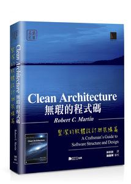 | **無瑕的程式碼：整潔的軟體設計與架構篇**（Clean Architecture） | Robert C. Martin | **精讀 Part III～V**（設計原則、元件原則、架構）；Part VI 案例快速翻閱 | 分層與依賴方向的判斷框架。須帶著批判閱讀：第一卷第 02 章的「過度工程地獄」，往往源自照本宣科本書 |
| 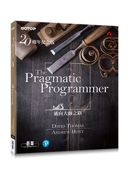 | **The Pragmatic Programmer 20 週年紀念版** | David Thomas、Andrew Hunt | **完整讀一遍**，短文體例易讀 | 「可逆性」、「正交性」是架構判斷的核心概念；第 1 章「知識資產」與本卷第 01 章互相呼應 |
| 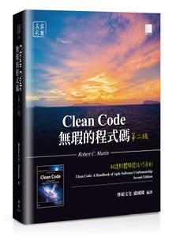 | **無瑕的程式碼：敏捷軟體開發技巧守則**（Clean Code） | Robert C. Martin | **精選章節**：第 1～3 章、第 7 章錯誤處理、**第 17 章程式碼的氣味與啟發**；第 15～16 章與附錄為特定語言案例，跳過 | 部分建議在業界有爭議（如函式須極短）。價值在於**作為審判 AI 審查意見的參照**：知道規則從何而來，才知道何時可以打破 |
| 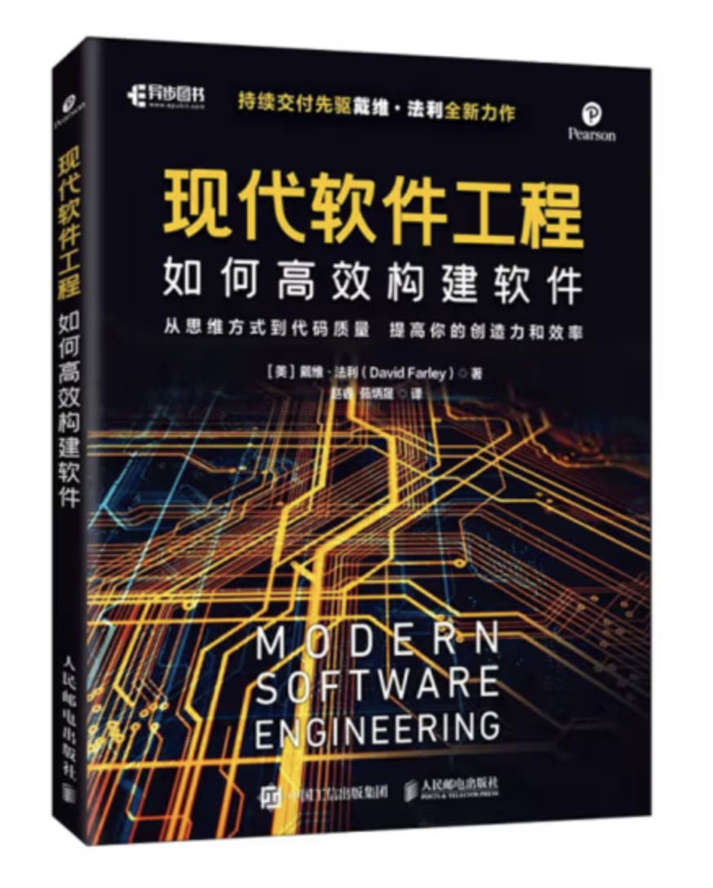 | **現代軟體工程：如何高效構建軟體**（Modern Software Engineering） | David Farley | **精讀第 1～3 部分**（工程本質、最佳化學習、管理複雜性）；第 4 部分工具與持續交付實務可快速翻閱 | 將軟體工程提煉為「探索學習（迭代、回饋、經驗主義）」與「管理複雜性（模組化、內聚、耦合、資訊隱藏）」兩大支柱，與本卷第 01 章的學習閉環高度共鳴 |
| 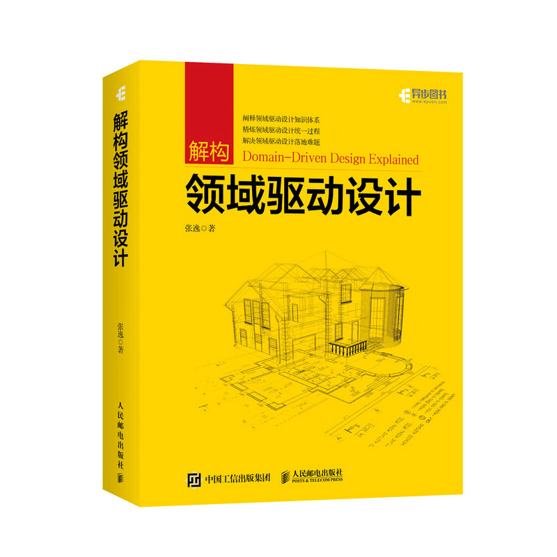 | **解構領域驅動設計** | 張逸 | **精讀第一篇與第三篇**（軟體複雜度剖析、同構系統、限界上下文與架構映射）；第二篇瀏覽即可；第四～五篇於實戰建模時對照查閱 | 將康威定律、限界上下文與分層架構（菱形對稱架構）串聯成完整體系，直接呼應第一卷與第三卷；讀時須取其邊界劃分心法，切忌將其全套流程當成僵化教條而落入過度工程 |
| 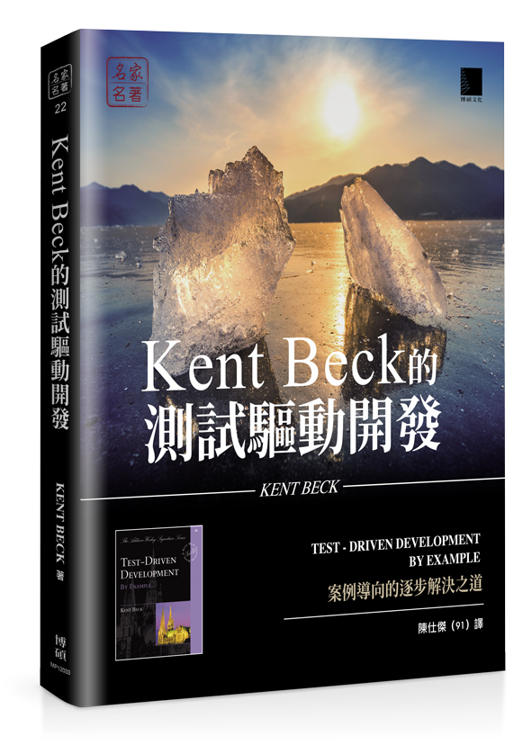 | **Kent Beck 的測試驅動開發：案例導向的逐步解決之道**（Test-Driven Development: By Example） | Kent Beck | **精讀 Part I（多幣別金錢案例）與 Part III（TDD 模式）**；Part II（xUnit 自舉實作）可快速略過 | TDD 的精髓不在測試語法，而在「以小步快跑與即時回饋控制設計複雜度」。在 AI 時代，「人先定義驗收測試邊界，再令 AI 生成實作」正是防範 AI 語義漂移的關鍵繩索 |
|  | **重構：改善既有程式的設計 第二版**（Refactoring, 2/e） | Martin Fowler | **精讀第 1～4 章**（重構原則、何時不該重構、**第 3 章程式碼的壞味道**）；第 6～12 章重構手法目錄僅瀏覽名稱，無須記憶步驟 | 機械式的重構步驟今日已由 IDE 與 AI 代勞；架構師不可替代的是第 2 章的「重構經濟學取捨」與第 3 章「聞出壞味道（Smell）並精準下達重構意圖」的直覺 |

## 二、 混合型：前半當思想讀，後半按需查閱

| 封面 | 書名 | 作者 | 讀法 | 理由 |
| :---: | :--- | :--- | :--- | :--- |
| 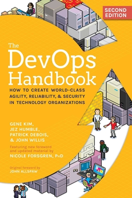 | **DevOps Handbook 2/e** | Gene Kim 等 | **Part I～II 精讀**（三步工作法、價值流、康威定律）；**Part III～VI 遇到問題再查** | 前半是組織與流程的思想，後半是持續交付、遙測等實務方案 |
| 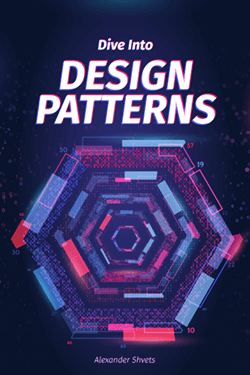 | **深入設計模式**（Dive Into Design Patterns / [Refactoring.Guru](https://refactoring.guru/design-patterns)） | Alexander Shvets | **精讀各模式的「問題情境、適用性、優缺點與模式間關係」**；具體程式碼範例直接跳過，網站加入書籤按需速查 | 當代最優秀的設計模式圖鑑，結構化極強。其「優缺點（Pros & Cons）與模式關係對比」直接鍛造**判斷層（Know-When / Why-Not）**，是審判 AI 過度工程的首選字典 |
| 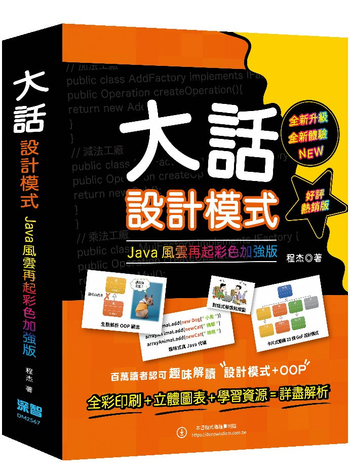 | **大話設計模式：JAVA 風雲再起彩色加強版** | 程杰 | **與上一本擇一即可（建議以 Refactoring.Guru 為主）**；若偏好故事體例，僅讀 SOLID 原則與常用模式章節 | 以對話故事破冰極易讀，但資訊密度與查閱效率不及 Refactoring.Guru；切忌兩本都從頭讀完，造成時間重複投資 |
| 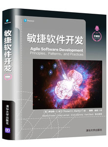 | **敏捷軟件開發：原則、模式與實踐**（Agile Software Development: Principles, Patterns, and Practices） | Robert C. Martin | **只讀第 7 章（何謂敏捷設計）與第 20 章（包的設計原則）**；第 8～12 章 SOLID 已由 Clean Architecture Part III 以更新的視角重述，薪水系統、氣象站等案例篇按需翻閱 | SOLID 與元件原則的**原始出處**，價值在於看見「設計如何在需求變化中一步步長出來」，而非一次到位。與 Clean Architecture 高度重疊，切忌兩本都通讀 |
|  | **單元測試的藝術 2/e**（The Art of Unit Testing） | Roy Osherove | **精讀第 1 章、第 8 章（可信任、可維護、可讀的測試）與第四部（第 9～11 章：組織導入、遺留程式碼、可測試性設計）**；第 3～6 章 stub / mock 概念快讀，C# 與 NUnit 語法一律跳過 | AI 生成測試的典型病灶——過度 mock、驗證實作細節、測試與程式碼一起漂移——正是第 8 章的審判標準。第 9 章「如何在組織內推動測試」則屬組織博弈，與第三卷呼應 |
| 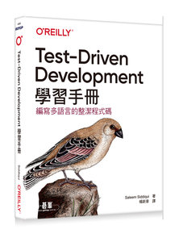 | **Test-Driven Development 學習手冊**（Learning Test-Driven Development） | Saleem Siddiqui | **與 Kent Beck 擇一（以 Kent Beck 為主）**；若想補強，僅讀第二部分（模組化與關注點分離）與第 13 章持續整合 | 以 Go、JavaScript、Python 三語重演 Kent Beck 的多幣別金錢案例，題材幾乎重疊；多語言對照對架構師邊際價值低 |
| 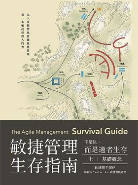 | **敏捷管理生存指南：不是快，而是適者生存（上下冊）** | 林裕丞 | **上冊第 1～2 章快讀、第 4 章（團隊戰術）精讀**；第 3 章 Scrum 基礎已熟悉可跳過；下冊答客問與實戰報告於推動團隊變革時按需查閱 | 作者為科技公司總經理出身，談的是**敏捷轉型在組織裡卡在哪裡**——領導者、會議、權責——而非儀式教學。與第五卷團隊心智、第三卷組織博弈直接相關 |

## 三、 方案型：讀目錄建立地圖，遇到問題再讀對應章節

| 封面 | 書名 | 作者 | 對應的實戰情境 | 讀法 |
| :---: | :--- | :--- | :--- | :--- |
| 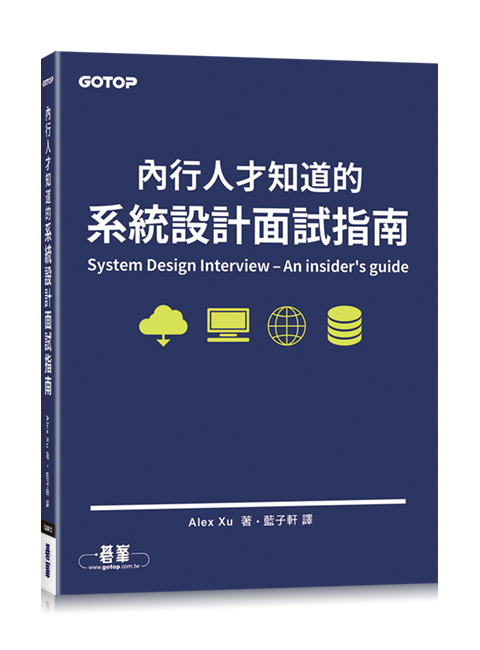 | **內行人才知道的系統設計面試指南**（System Design Interview） | Alex Xu | 第 2 章粗估（Back-of-the-envelope）可直接用於工作負載評估；第 4 章限流器、第 10 章通知系統，對應對外收集端點與通知服務的設計 | **第 1～2 章現在就讀**，其餘按需查閱；面試只是包裝，內容是優質的方案目錄 |
|  | **超大流量系統解決方案** | 高翔龍 | 第 3 章限流削峰對應對外收集端點；第 4 章讀寫最佳化對應高頻寫入的行為事件；第 5 章分庫分表對應按月分表的日誌儲存 | **上架備查**；與上一本重疊處先查上一本，需要大型促銷的實戰細節時再翻本書 |
|  | **SRE 實踐與開發平台指南** | 黃冠元 | Part 1 團隊介面與事件管理、第 8 章觀測與監控，對應延後中的監控建置 | **監控議題重啟時再讀**，目前擱置 |
| 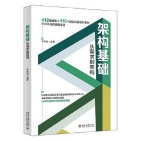 | **架構基礎：從需求到架構** | 尹洪亮 | 第 4～5 章登入、單一登入、OAuth 2.0、RBAC 與 Token；第 6 章操作稽核與日誌；第 7 章驗證碼、防重放與防暴力破解；第 8 章簡訊、站內信與推播的分級設計 | **讀目錄上架備查**；第 1 章職涯規劃與第 2～3 章分散式通論淺於前述書目，可跳過。價值在於把後台系統的「通用橫切能力」整理成清單，設計新系統時拿來逐項核對有無遺漏 |
| 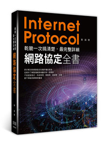 | **乾脆一次搞清楚：最完整詳細網路協定全書** | 劉超 | 第 3 章 TCP 連線管理與可靠性，對應長連線、逾時與重試設計；第 5 章 DNS、CDN 與資料中心；第 7～8 章容器網路與 RPC 協定，對應服務間通訊選型 | **第 3 章現在就讀**，其餘遇到網路問題再查。架構判斷中的「延遲與失敗」最終都落在這一層物理規律上，第二卷的單體 vs 微服務延遲代價即由此而來 |

## 四、 練功型：只留一本，其餘放棄

| 封面 | 書名 | 作者 | 決定 | 理由 |
| :---: | :--- | :--- | :--- | :--- |
| 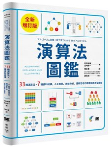 | **演算法圖鑑** | 石田保輝、宮崎修一 | **保留，快速翻完一遍後上架** | 正好提供架構師所需的「資料結構取捨清單與複雜度直覺」，圖解輕量，投報率最高 |
|  | **算法競賽** | 羅勇軍、郭衛斌 | **放棄** | 競賽解題能力與架構工作幾乎沒有交集 |
|  | **提升程式設計師的面試力**（Cracking the Coding Interview） | Gayle Laakmann McDowell | **放棄**（近期有面試計畫時再啟用） | Big O 部分已由演算法圖鑑涵蓋；系統設計章節不如 Alex Xu |
| 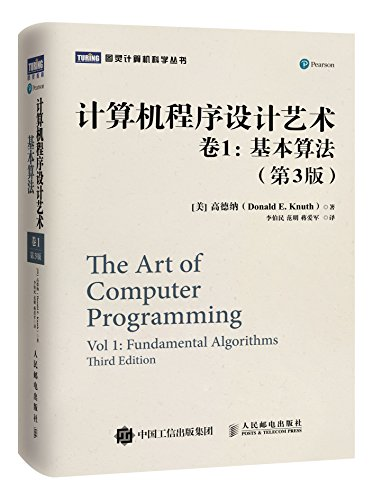 | **計算機程序設計藝術（共 5 卷）**（The Art of Computer Programming） | Donald E. Knuth | **放棄通讀**（僅作鎮宅典藏或極端底層問題之終極字典） | 計算機科學傳世聖經，但以組合語言（MMIX）與嚴密數學推導展開，啃讀的邊際時間成本極高，與應用架構決策幾乎無交集；底層演算法推導今日交由 AI 解讀效率遠勝原著 |
| 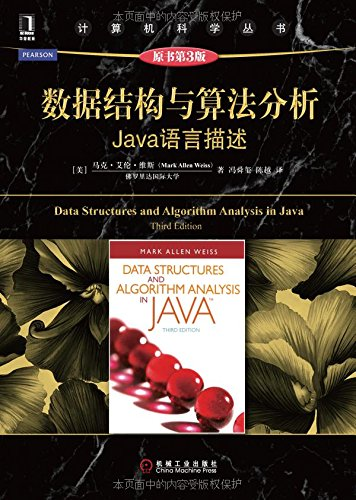 | **數據結構與算法分析：Java 語言描述**（Data Structures and Algorithm Analysis in Java） | Mark Allen Weiss | **放棄通讀，降級備查** | 大學計算機科學經典教材，比《演算法圖鑑》嚴密。但書中大量篇幅在於手刻紅黑樹、B 樹等底層實作——今日 JDK 與 AI 已完全代勞，用《演算法圖鑑》建立直覺即可，僅在需深究特定結構複雜度時翻閱 |
| 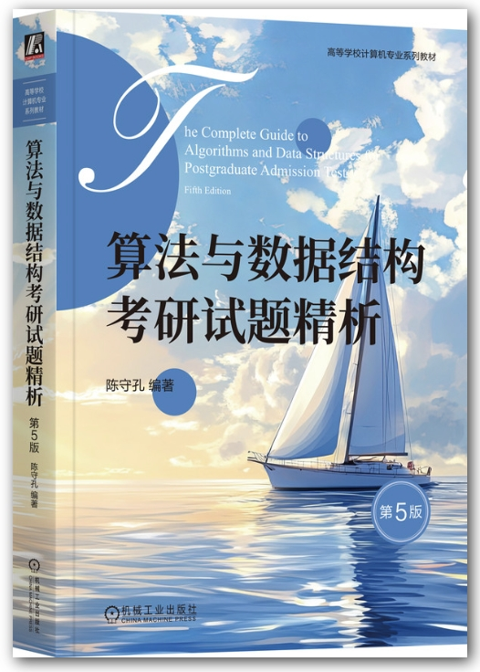 | **算法與數據結構考研試題精析** | 陳守孔 等 | **放棄** | 專為研究所入學考試（408 統考）設計的應試刷題書，充斥紙筆推演與刁鑽題型，與真實系統架構決策零交集 |
| 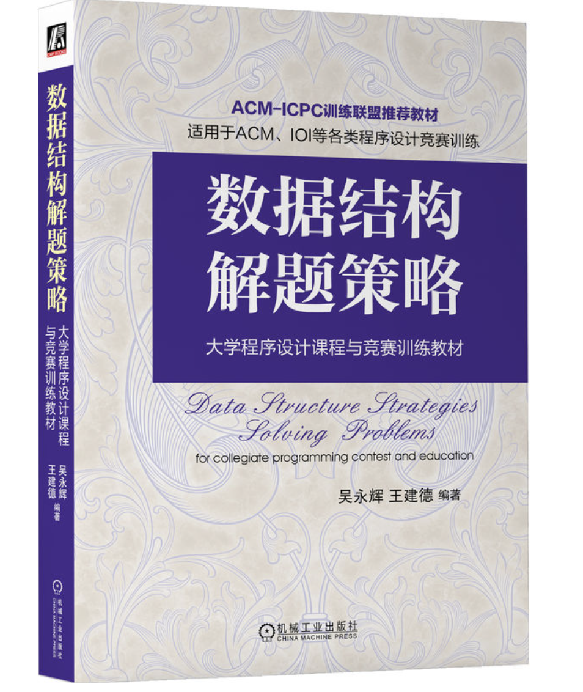 | **數據結構解題策略** | 吳永輝、王建德 | **放棄** | ACM-ICPC / IOI 大學程式競賽訓練教材，與《算法競賽》同屬競技解題範疇，對架構師的時間投報率趨近於零 |
| 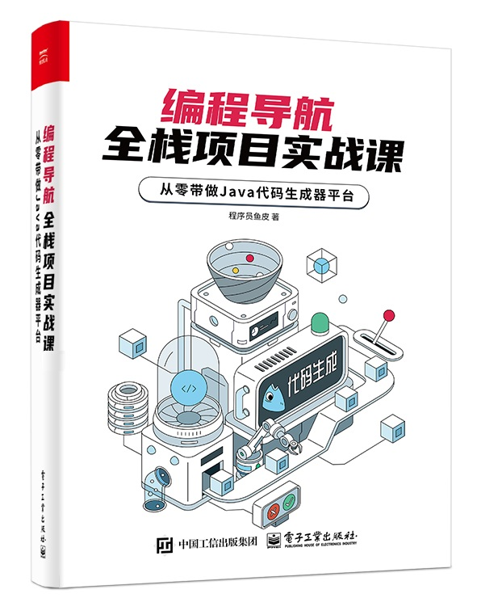 | **編程導航，全棧項目實戰課：從零帶做 Java 代碼生成器平台** | 程式設計師魚皮 | **放棄逐章實作**（僅花 30 分鐘翻閱目錄與產品化思路即可） | 手把手帶寫全端 CRUD 與代碼生成器的初階實戰教程。在 AI Agent 時代，腳手架與樣板代碼生成已被 AI 徹底降維取代，無須再花時間跟著敲代碼 |
| 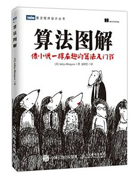 | **算法圖解**（Grokking Algorithms） | Aditya Bhargava | **放棄通讀**（與演算法圖鑑擇一，已選後者）；僅花 15 分鐘翻第 11 章 | 與《演算法圖鑑》定位完全相同。第 11 章點到的反向索引、布隆過濾器、平行演算法，恰是架構師真正會遇到的結構，值得一瞥 |
| 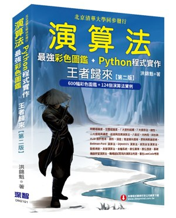 | **演算法：最強彩色圖鑑 + Python 程式實作 王者歸來（第二版）** | 洪錦魁 | **放棄** | 圖鑑加 Python 實作的大部頭，覆蓋面與《演算法圖鑑》重疊，額外的部分是逐行實作——正是 AI 已代勞的那一層 |
| 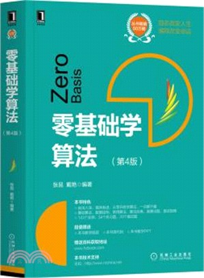 | **零基礎學算法（第 4 版）** | 張昆、戴豔 | **放棄** | 入門教材，以 C 語言實作與數學題、資訊奧賽題為主，對已有實務經驗者無增量 |
| 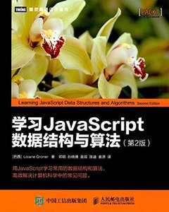 | **學習 JavaScript 數據結構與算法 第 2 版**（Learning JavaScript Data Structures and Algorithms） | Loiane Groner | **放棄** | 以特定語言重新實作基礎資料結構，內容與前述各書重複，且綁定語言語法 |
|  | **演算法洞見：遞推與遞迴** | 劉鐵猛 | **放棄** | 遞迴、動態規劃與圖論的解題專書，屬競技與面試練功範疇，與架構決策交集極低 |
|  | **刷題實戰筆記：演算法工程師求職加分的祕笈**（labuladong 的算法小抄） | 付東來（labuladong） | **放棄**（近期有面試計畫時再啟用，與 Cracking the Coding Interview 同列） | LeetCode 解題模板書，口碑極佳但目標是面試通關。在本書單中屬面試備用，不屬日常投資 |

---

## 五、 建議閱讀順序

1. **系統設計面試指南 第 1～2 章** 與 **網路協定全書 第 3 章**：粗估能力可立即用於工作負載評估，TCP 的物理規律則是逾時、重試與服務切分判斷的底層。
2. **Clean Architecture Part III～V** 與 **解構領域驅動設計 第一、三篇**：直接對應現行的分層規範、限界上下文與模組邊界裁決。
3. **重構 第二版 第 1～4 章**、**Refactoring.Guru（深入設計模式）**、**Kent Beck 的測試驅動開發 Part I、III** 與 **單元測試的藝術 第 8 章**：鍛造「聞出壞味道（Smell）」的直覺、審判 AI 過度工程與劣質測試的標尺，以及用測試邊界約束 AI 的能力。
4. **人月神話**精選章節與 **敏捷管理生存指南 上冊第 4 章**：從工程規律走向組織規律。
5. **The Pragmatic Programmer** 與 **現代軟體工程 第 1～3 部分**：建立回饋閉環與控制複雜度的核心工程觀。
6. **DevOps Handbook 前半、SRE 實踐與開發平台指南**：待維運與監控議題重啟時。
7. 其餘上架備查；**演算法圖鑑**利用空檔翻完。
