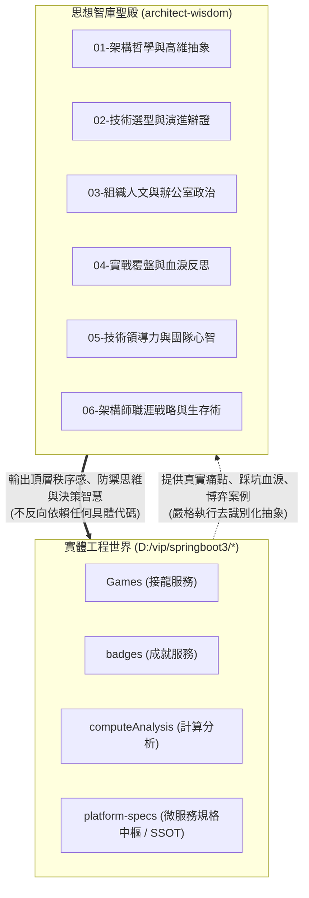

# CONTEXT.md (智庫脈絡、心智模型與知識庫全景)

> 本檔案記錄《Architect Wisdom》的建立脈絡、心智地圖、與底層工程生態的邊界關係，以及內容演進機制。

---

## 一、 智庫誕生脈絡（Context & Genesis）

在企業級分散式系統（如高並發電商、文字接龍遊戲引擎、大數據行為分析、跨微服務治理）的真實開發與維護過程中，工程師常面臨兩層割裂：

1. **工程落地的瑣碎性 vs. 架構設計的宏觀性**：  
   日常專案（如 `Games`、`badges`、`platform-specs`）被具體的語法、Bug 修復、連線池配置、JSON 格式與聯調進度填滿。如果在這些業務專案中混入哲學與政治討論，不僅容易失焦，更會帶來極高的安全與政治連帶風險。
2. **教科書理論的完美無瑕 vs. 真實戰場的殘酷多變**：  
   市面上的技術書籍充斥著「理想化的架構圖與教條」，避而不談真實世界中**人性脆弱、組織利益衝突、高管洗履歷、技術債死鎖與伺服器物理限制**。

為此，作者決定在所有業務程式碼庫之外，建立這座獨立的**《Architect Wisdom》**智庫：
* **作為「思考的避風港」**：脫離程式碼的低維糾纏，進行純粹的思維覆盤。
* **作為「去識別化的數位智庫」**：將真實踩坑的血淚史，提煉為超越特定公司、伴隨一生的軟實力資產。

---

## 二、 與底層微服務生態的隔離邊界（Physical & Logical Air Gap）

本專案與周圍業務專案的關係如下圖所示：

* **絕對物理隔離**：本專案不引入任何 `pom.xml`、`package.json`，不包含任何可運行的商業進程。
* **單向思想反哺**：真實世界的戰鬥經驗進入本智庫進行「思想蒸餾」；智庫提煉出的心智模型，反哺給架構師在真實世界中指引決策。

---

## 三、 六大卷軸體系詳解（Taxonomy & Scope）

| 卷軸目錄 | 核心主題 | 探討範圍 |
| :--- | :--- | :--- |
| **01-架構哲學與高維抽象** | 秩序、模型與邊界 | 探討由上而下（Top-Down）的秩序感、DDD（領域驅動設計）心智蒸餾、規格先行（Contract-First）之無形統治、複雜度控制 |
| **02-技術選型與演進辯證** | 典範轉移與物理極限 | 單體 vs 微服務的真假辯證、務實拆分法則、進程邊界的物理延遲與序列化稅、CQRS/事件驅動解耦 |
| **03-組織人文與辦公室政治** | 權力地盤與責任隔離 | 康威定律實戰、單體連坐法 vs 領地爆炸半徑隔離、深藏大腦的降維生存、新技術浪潮（焦慮驅動開發 ADD）下的斷局與借假修真、防範因果倒置甩鍋 |
| **04-實戰覆盤與血淚反思** | 戰場死人堆裡的真理 | 電商高並發卡死教訓、垂直堆算力極限、跨服務長鏈條同步依賴引發的雪崩覆盤 |
| **05-技術領導力與團隊心智** | 團隊文化與工程治理 | 如何推動團隊技術演進而不引發排斥、工程師的心理動線、代碼評審（CR）背後的人文藝術 |
| **06-架構師職涯戰略與生存術** | 個人護城河與職業期權 | AI 時代的學習戰略與判斷力養成、關鍵人風險（Key Person Risk）的雙面刃、將技術專長轉化為不可替代的威望、技術人的職涯第二曲線 |

---

## 四、 知識演進工作流（Distillation Workflow）

每當作者與 AI Agent（老謀士）展開一段新的思辨討論時，依循以下四步驟將智慧入庫：

1. **碰撞與詰問（Colloquy & Grilling）**：
   * 作者提出一個困惑、一則網路文章、一段真實踩坑經歷或組織人事動態。
   * AI Agent（老謀士）以雙重視角進行深度剖析（硬核技術客觀性 + 組織人性幽微處）。
2. **抽象與去識別化（Abstraction & Anonymization）**：
   * 將特定人名、公司名稱、敏感業務欄位抽離，替換為通用的架構術語與組織角色。
3. **編纂成冊（Codification）**：
   * 按照 `AGENTS.md` 規定的標準模板（箴言、痛點、本質剖析、破局心法、Mermaid 圖表）落實為 Markdown 檔案。
4. **索引與編年同步（Indexing & Chronologizing）**：
   * 同步更新 `README.md` 的導讀目錄與 `CONTEXT.md` 的卷軸全景。
   * 若達到「認知里程碑」（開闢新卷軸、入庫分水嶺篇章、重大思維典範轉移），依據 `AGENTS.md` 規範在 `CHANGELOG.md`（智庫編年誌）記上一筆。

